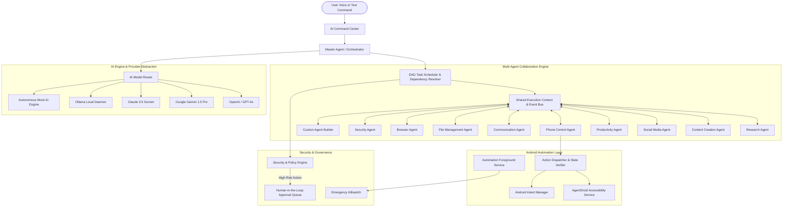

<div align="center">

> ### 📢 Official Contract Address (CA): **Soon Available**
> *The official smart contract address will be published here upon launch. Please beware of unauthorized contracts or impersonation accounts.*

</div>

<div align="center">
  
  <h1>AgentsDroid 🤖📱</h1>
  <p><strong>Production-Ready Multi-Agent AI Operating System for Android</strong></p>
  <p>
    <a href="https://github.com/agentsdroid/agentsdroid/releases"></a>
    <a href="https://github.com/agentsdroid/agentsdroid/blob/main/LICENSE"></a>
    <a href="https://github.com/agentsdroid/agentsdroid/actions"></a>
    <a href="website/index.html"></a>
  </p>
</div>

AgentsDroid transforms Android into an autonomous, intelligent multi-agent environment where a central **Master Agent** decomposes complex natural language goals into Directed Acyclic Graph (DAG) task trees, delegates subtasks across specialized AI agents, executes native Android UI automations via Accessibility Services and Intents, enforces zero-trust human-in-the-loop security, and manages context across 5 distinct memory tiers.

---

## 🌟 Core Product Vision

AgentsDroid is **not an ordinary AI chatbot**. It is an intelligent multi-agent platform where specialized agents collaborate to perform tasks, interact with Android applications, automate workflows, manage social media, and assist users with everyday digital activities.

```
User: "Manage my social media today. Research competitors, create content, prepare posts, analyze engagement, and organize my replies."
```



---

## 🏗 Multi-Agent Fleet Specification

Every agent implements a standardized contract (`Agent`), managing its own state lifecycle (`IDLE`, `THINKING`, `PLANNING`, `ASSIGNED`, `RUNNING`, `WAITING_FOR_APPROVAL`, `COMPLETED`, `FAILED`, `CANCELLED`):

| Agent | Role | Capabilities | Primary Tools |
| :--- | :--- | :--- | :--- |
| **Master Agent** | Orchestrator | Natural language understanding, task decomposition, dependency resolution, synthesis reporting | `GoalDecomposer`, `ReportSynthesizer`, `AgentCoordinator` |
| **Phone Control Agent** | Android Automation | App launching, UI element clicking, text typing, screen scrolling, navigation, screen reading | `AccessibilityDriver`, `IntentLauncher`, `ScreenInspector`, `StateVerifier` |
| **Social Media Agent** | Social Management | X, Instagram, Facebook, LinkedIn, Telegram, Discord, YouTube, Reddit; posts, calendar, replies | `SocialComposer`, `HashtagEngine`, `CalendarOrganizer`, `ThreadBuilder` |
| **Content Creation Agent** | Creative & Copy | Articles, ad copy, captions, marketing hooks, document summaries, tone transformation | `ArticleWriter`, `MarketingStrategist`, `CopyDrafter`, `ToneTransformer` |
| **Research Agent** | Intelligence | Web exploration, competitor analysis, topic investigation, structured citation reports | `WebSearchEngine`, `CompetitorComparator`, `CitationCompiler` |
| **Communication Agent** | Messaging & Email | Email drafts, conversation summaries, smart replies, notification triaging | `EmailDrafter`, `ThreadSummarizer`, `ActionItemExtractor` |
| **File Management Agent** | Storage Organization | File scanning, categorization, duplicate detection, text file creation, PDF summarization | `FileScanner`, `DuplicateDetector`, `DocumentSummarizer`, `SafeFileDeleter` |
| **Productivity Agent** | Schedule & Tasks | Task lists, reminders, daily time-blocked schedules, overdue tracking | `DailyScheduleBuilder`, `TaskTracker`, `ReminderManager` |
| **Browser Agent** | Web Automation | Multi-step web workflows, form interaction, extraction, page summaries | `WebNavigator`, `PageExtractor`, `WebSummarizer` |
| **Security Agent** | Protection & Policy | URL inspection, permission auditing, prompt injection defense, audit trail logging | `UrlInspector`, `PermissionAuditor`, `PromptInjectionDetector` |
| **Custom Agent Builder** | User-Defined Agents | Dynamic creation of specialized agents with custom prompts, models, toolkits, and limits | User-configurable |

---

## ⚡ Android Device Automation Engine

AgentsDroid features a dedicated, native Android automation layer that **requires zero root access**:

1. **`AgentDroidAccessibilityService`**:
   - Inspects UI hierarchy and node attributes (`text`, `contentDescription`, `viewIdResourceName`, `isClickable`, `isEditable`).
   - Performs direct node actions (`ACTION_CLICK`, `ACTION_SET_TEXT`, `ACTION_SCROLL_FORWARD`).
   - Dispatches gesture clicks at element center coordinates when standard click events are intercepted by custom views.
   - Global system navigation (`GLOBAL_ACTION_BACK`, `GLOBAL_ACTION_HOME`).
2. **`ActionDispatcher`**:
   - Central executor validating actions before invocation: `OPEN_APP`, `CLICK_ELEMENT`, `TYPE_TEXT`, `SCROLL_SCREEN`, `GO_BACK`, `TAKE_SCREENSHOT`, `READ_SCREEN`, `OPEN_URL`, `COPY_TEXT`, `PASTE_TEXT`, `SEARCH_DEVICE`, `CREATE_FILE`, `DELETE_FILE`, `SEND_EMAIL`, `POST_SOCIAL`.
3. **`StateVerifier`**:
   - Ensures requested actions actually modified the Android state (verifies foreground package changes, screen text appearance, and file creation).
4. **`AutomationForegroundService` & Emergency Killswitch**:
   - Foreground service displays an ongoing notification during multi-agent automation with an instant **"EMERGENCY STOP"** action.

---

## 🔒 Human-in-the-Loop Security Model

Actions are strictly categorized into risk tiers to protect user safety and prevent unauthorized automation:

- **🟢 LOW RISK** (Automatically executed): Summarizing, researching, reading authorized screens, drafting notes.
- **🟡 MEDIUM RISK** (Requires standard approval or user opt-in): Modifying drafts, non-destructive app settings, staging social posts.
- **🔴 HIGH RISK** (Mandatory explicit confirmation): Publishing public social posts, sending emails/messages, deleting files, making payments, modifying system permissions. High-risk tasks pause the DAG and post an `ApprovalRequest` to the user in the UI.
- **🛡 Prompt Injection Defense**: Untrusted external inputs are scanned for prompt injection attacks (`ignore previous instructions`, `system prompt override`, `root access`, etc.) and sanitized before context ingestion.

---

## 🧠 5-Tier Memory Architecture

1. **Session Memory**: In-flight state during current conversational session.
2. **Task Memory**: Intermediate outputs shared between dependent agents via `SharedTaskContext`.
3. **Agent Memory**: Agent-specific operational guidelines, tool history, and domain preferences.
4. **User Preferences**: User writing style, platform choices, risk thresholds, schedule habits.
5. **Long-Term Memory**: Indexed historical project summaries, document tags, and persistent knowledge stored in Room DB.

---

## 🎨 User Interface & Navigation (Material 3)

Designed with a futuristic, dark-first AI OS aesthetic (deep obsidian surfaces, glowing cyan/violet accents, animated execution pulses, and glassmorphism cards):

- **🏠 Home Dashboard**: System overview, Master Agent status, emergency halt, active agents count, pending approvals, quick command bar.
- **💬 AI Command Center**: Conversational interface with Master Agent, live streaming responses, visual DAG task tree, and voice command dictation.
- **👥 Agents Dashboard**: Complete fleet directory, status indicators, assigned models, and quick toggles.
- **🔍 Agent Details**: Deep inspection of capabilities, tools, permissions, and inference temperature controls.
- **⚡ Automation Center**: Background routines, scheduled triggers (WorkManager), and natural language workflow builder.
- **📱 Social Media Center**: Multi-platform manager (X, LinkedIn, Instagram, etc.), draft post approval queue, and engagement metrics.
- **📜 Activity Center**: Real-time tamper-evident timeline of all agent activities, phone actions, and security audits.
- **⚙️ Settings**: AI Provider configuration, Android Keystore API key encryption, memory tier inspection/clearing, and accessibility status.
- **🛠 Custom Agent Builder**: Intuitive form to deploy custom specialized agents.

---

## 📂 Project Structure

```
agentdroid/
├── app/
│   ├── src/main/
│   │   ├── AndroidManifest.xml
│   │   ├── java/com/agentdroid/app/
│   │   │   ├── AgentDroidApplication.kt
│   │   │   ├── MainActivity.kt
│   │   │   ├── ai/
│   │   │   │   ├── client/HttpAiProvider.kt
│   │   │   │   ├── provider/AiProvider.kt
│   │   │   │   ├── provider/AutonomousMockProvider.kt
│   │   │   │   └── router/AiModelRouter.kt
│   │   │   ├── automation/
│   │   │   │   ├── accessibility/AgentDroidAccessibilityService.kt
│   │   │   │   ├── action/ActionDispatcher.kt
│   │   │   │   ├── action/EmergencyKillswitch.kt
│   │   │   │   ├── action/StateVerifier.kt
│   │   │   │   └── service/AutomationForegroundService.kt
│   │   │   ├── data/
│   │   │   │   ├── local/database/AgentDroidDatabase.kt
│   │   │   │   ├── local/dao/Daos.kt
│   │   │   │   ├── local/entity/Entities.kt (16 Room Entities)
│   │   │   │   └── local/preferences/SecurePreferencesManager.kt
│   │   │   ├── domain/
│   │   │   │   ├── agent/ (MasterAgent, PhoneControl, Social, Content, etc.)
│   │   │   │   ├── memory/AgentMemoryManager.kt
│   │   │   │   ├── model/ (TaskModels, AgentDefinition, CoreEnums, etc.)
│   │   │   │   ├── orchestrator/ (AgentOrchestrator, DAGScheduler, SharedTaskContext)
│   │   │   │   └── workflow/ (WorkflowEngine, AgentDroidWorker)
│   │   │   └── ui/
│   │   │       ├── components/ (GlassCard, AgentStatusBadge, TaskCard, RiskBadge)
│   │   │       ├── navigation/ (Screen, Navigation)
│   │   │       ├── screens/ (Dashboard, Command, Agents, Details, Automation, etc.)
│   │   │       └── theme/ (Color, Theme, Type)
│   │   └── res/
│   └── src/test/ (Unit & Integration Tests)
├── build.gradle.kts
└── settings.gradle.kts
```

---

## 🚀 Building & Testing

### Prerequisites
- JDK 17 or JDK 21
- Android SDK Platform 34 and Build-Tools 34.0.0
- Gradle 8.7+

### Compile & Build Debug APK
```bash
./gradlew assembleDebug
```
The compiled APK will be generated at:
`app/build/outputs/apk/debug/app-debug.apk`

### Run Unit & Integration Tests
```bash
./gradlew testDebugUnitTest
```
Tests verify:
- DAG topological sort and parallel task execution (`DAGSchedulerTest`)
- Natural language goal decomposition and multi-agent report synthesis (`AutonomousMockProviderTest`)
- Emergency killswitch security intervention (`EmergencyKillswitchTest`)
- Prompt injection detection against untrusted inputs (`SecurityPromptInjectionTest`)
