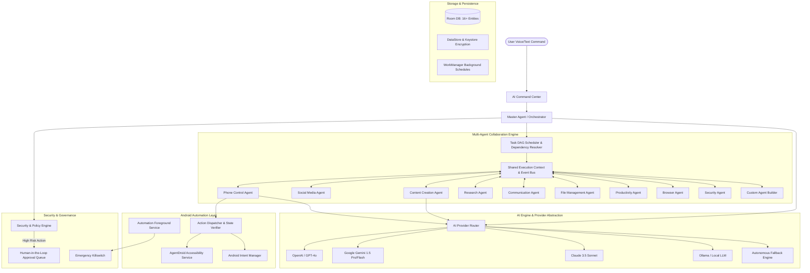

# AgentDroid: Production-Ready Multi-Agent AI Operating System for Android

## 1. System Architecture Overview

AgentDroid transforms Android into an autonomous, intelligent multi-agent environment where a central **Master Agent** decomposes complex intents, coordinates specialized agents, executes device automations, generates content, enforces human-in-the-loop security, and manages context across 5 distinct memory tiers.

## 2. Multi-Agent Engine Design

### 2.1 Standardized Agent Interface (`Agent`)
Every agent implements a contract:
- `id: String`
- `name: String`
- `role: AgentRole`
- `description: String`
- `capabilities: List<AgentCapability>`
- `availableTools: List<AgentTool>`
- `requiredPermissions: List<String>`
- `executionStatus: StateFlow<AgentExecutionState>`
- `execute(task: Task, context: SharedTaskContext): Flow<AgentStepResult>`

### 2.2 Execution States
- `Idle`
- `Thinking`
- `Planning`
- `Assigned`
- `Running`
- `WaitingForApproval`
- `Completed`
- `Failed`
- `Cancelled`

### 2.3 Task DAG & Orchestration
1. **Intent Parsing & Subtask Generation**: Master Agent uses structured LLM output (or fallback reasoning engine) to break user goal into tasks with explicit dependencies (`dependsOn`).
2. **Topological Sort & Parallel Dispatch**: Tasks with satisfied dependencies run concurrently within concurrency limits (default max 4 parallel agents).
3. **Shared Context**: Intermediate outputs (e.g. Research Agent findings) are stored in `SharedTaskContext` and injected into dependent tasks (e.g. Content Agent creating social posts based on competitor research).
4. **Resilience**: Configurable exponential backoff retries, execution timeouts (e.g. 60s default), and cancellation propagation.

## 3. Specialized Agents Specification

1. **Master Agent**: Main orchestrator, intent classification, subtask decomposition, agent coordination, report synthesis, human approval escalation.
2. **Phone Control Agent**: Accessibility-driven UI automation (`OPEN_APP`, `CLICK_ELEMENT`, `TYPE_TEXT`, `SCROLL_SCREEN`, `GO_BACK`, `TAKE_SCREENSHOT`, `READ_SCREEN`, `OPEN_URL`, `COPY_TEXT`, `PASTE_TEXT`, `SEARCH_DEVICE`, `CREATE_FILE`). Verifies UI state changes after action.
3. **Social Media Management Agent**: Supports X, Instagram, Facebook, LinkedIn, Telegram, Discord, YouTube, Reddit. Content calendar, post generation, sentiment analysis, notification summaries, anti-spam policy compliance.
4. **Content Creation Agent**: Multi-format content engine (articles, ads, scripts, email drafts, summaries, tone rewriting).
5. **Research Agent**: Web search, multi-source fact retrieval, competitor analysis, structured citation reports.
6. **Communication Agent**: Email drafting, conversation summaries, reply suggestion, notification triaging. User authorization required before message dispatch.
7. **File Management Agent**: File scanning, categorization, duplicate detection, text file creation, PDF summarization. Destructive operations strictly require user confirmation.
8. **Productivity Agent**: Task creation, daily scheduling, reminders, overdue tracking, calendar integration.
9. **Browser Agent**: URL navigation, form filling, webpage summarization, multi-step web queries with confirmation on critical forms.
10. **Security Agent**: Link & URL reputation analysis, app permission auditor, phishing warnings, prompt injection detection, AgentDroid security audit logging.
11. **Custom Agent Builder**: Allows users to dynamically define new agents with custom system instructions, toolkits, risk thresholds, and trigger rules.

## 4. Android Automation & Accessibility Layer
- `AgentDroidAccessibilityService`: Connects to Android accessibility tree, locates nodes by ID, text, or contentDescription, fires gestures, clicks, text input, and scroll actions.
- `AutomationForegroundService`: Displays active ongoing status notification with an instant **"EMERGENCY STOP"** action.
- Action verification: Checks package name or expected UI text after an action to guarantee execution state change.

## 5. Security & Human-in-the-Loop Model
- **LOW_RISK**: Research, summarization, drafting, read-only inspections. Automatically approved.
- **MEDIUM_RISK**: File editing, social draft updates, non-destructive app settings.
- **HIGH_RISK**: Publishing public social posts, sending emails/messages, deleting files, making payments, modifying system settings. Pauses DAG and yields an `ApprovalRequest` to the user in the UI.

## 6. Project Roadmap & Implementation Phases

- **Phase 1: Project Setup & Gradle Configuration**: Android application Gradle build system, Compose, Material 3, Room, WorkManager, Hilt, Coroutines, Serialization.
- **Phase 2: Database & Domain Layer**: 16 Room entities, DAOs, Database, encryption helper, SharedTaskContext, Agent models, Task DAG.
- **Phase 3: AI Provider Architecture & Mock/Online Engines**: Provider interface, OpenAI, Gemini, Anthropic, Ollama, and Autonomous Mock Fallback engine for zero-credential operation.
- **Phase 4: Agent Implementations & Orchestrator**: Master Agent + 9 specialized agents + Custom Agent Builder.
- **Phase 5: Android Device Automation Engine**: Accessibility Service, Action Dispatcher, Intent Manager, Foreground Service with Emergency Stop.
- **Phase 6: UI Design System & Screens**: Premium Obsidian Black AI OS theme (#08090B, #12151A, #A78BFA), Canvas glowing AI core visualizer, Command Center, Home Dashboard, Agents Dashboard, Agent Details, Automation Center, Social Media Center with animated bar charts, Activity Center with vertical audit timeline, Custom Agent Studio, and Settings.
- **Phase 7: End-to-End Testing & Verification**: Unit tests (28 passing tests across DAGScheduler, EmergencyKillswitch, SecurityPromptInjection, PluginRegistry, and StrictRealAiModeTest), full compilation verification, APK generation (`app-debug.apk`, 19MB).

## 8. Strict Real AI Mode & Complete Error Architecture

### 8.1 Zero-Mock Policy
- **Elimination of Fake Responses**: All placeholder strings, simulated agent thinking, fake research results, hardcoded competitor matrices, fake schedules, and mock social media drafts are completely removed from production execution paths.
- **Pre-flight AI Validation**: Master Agent verifies active provider connectivity before starting execution. If offline, execution halts immediately with a clear, actionable error card directing the user to Settings → AI Providers.
- **Connection States (12 Discrete States)**: `NOT_CONFIGURED`, `CONFIGURED`, `CONNECTING`, `CONNECTED`, `AUTHENTICATION_FAILED`, `INVALID_API_KEY`, `MODEL_NOT_FOUND`, `RATE_LIMITED`, `NETWORK_ERROR`, `PROVIDER_UNAVAILABLE`, `REQUEST_TIMEOUT`, `UNKNOWN_ERROR`. Rule: `CONFIGURED != CONNECTED` (verification requires a successful lightweight HTTP health check).

### 8.2 Centralized AI Connection Manager (`AiConnectionManager`)
- Single source of truth for AI provider availability.
- Performs real lightweight HTTP model pings:
  - OpenAI / Compatible: `GET /v1/models` with Bearer auth.
  - Gemini: `GET /v1beta/models?key=API_KEY`.
  - Anthropic: `GET /v1/models` with `x-api-key`.
  - Ollama: `GET /api/tags`.
- Exposes `systemStatus: StateFlow<AiSystemStatus>` and `providerStatuses: StateFlow<Map<String, ProviderConnectionStatus>>`.

### 8.3 Centralized Error System (`AiError`)
- Standardized error model with 15 categories: `AI_NOT_CONFIGURED`, `API_KEY_MISSING`, `API_KEY_INVALID`, `MODEL_NOT_FOUND`, `PROVIDER_UNAVAILABLE`, `RATE_LIMIT_EXCEEDED`, `NETWORK_UNAVAILABLE`, `REQUEST_TIMEOUT`, `INVALID_RESPONSE`, `CONTENT_BLOCKED`, `QUOTA_EXCEEDED`, `AGENT_EXECUTION_FAILED`, `TOOL_EXECUTION_FAILED`, `PERMISSION_DENIED`, `UNKNOWN_ERROR`.
- Actionable recovery: `CONNECT_PROVIDER`, `OPEN_SETTINGS`, `UPDATE_API_KEY`, `TEST_CONNECTION`, `SELECT_ANOTHER_MODEL`, `RETRY_NOW`, `CHECK_NETWORK`, `CHECK_PROVIDER_USAGE`.
- Automatic credential redaction: Never logs or exposes Bearer tokens, API keys, or Authorization headers in technical logs.

### 8.4 Dedicated UI Error Components
- `AIConnectionErrorCard`: Obsidian card with actionable recovery and direct navigation to Settings.
- `ProviderErrorCard`: Live provider state badge, technical error details, and "Test Connection" / "Update Key" actions.
- `TaskFailureCard`: Subtask error summary with role badge and retry action.
- `NetworkErrorBanner`: Compact offline warning banner with retry action.
- `ModelStatusIndicator`: Real-time pill showing model name and status dot.

## 7. Obsidian Black UI/UX Redesign System

- **Color Foundation**: `#08090B` (Deep Obsidian background), `#0D0F12` (Secondary charcoal background), `#12151A` (Graphite card surface), `#181C22` (Elevated surface), `#252A33` (Card border).
- **Accents**: `#A78BFA` (Primary lavender violet for AI status/active highlights), `#8B5CF6` (Secondary violet), `#60A5FA` (Electric blue for telemetric and analytics data), `#34D399` (Mint emerald for success), `#FBBF24` (Cyber amber for warnings), `#F87171` (Crimson for errors).
- **Master Agent Visualizer**: Canvas-drawn glowing core with state-driven dynamic radial breathing, 3 expanding translucent ripple waves, dual counter-rotating orbital satellite nodes, and color transitions corresponding to IDLE, LISTENING, THINKING, PLANNING, RUNNING, COMPLETED, and FAILED states.
- **AI Command Dock**: Floating bottom input bar with animated purple focused border, speech-to-text voice recognition intent trigger, attachment launcher, and submit action.
- **Multi-Agent Task Graph**: DAG dependency hierarchy visualization displaying step numbers, execution state badges, risk ratings, and live execution progress.
- **Social Media Hub**: Interactive cross-platform channel strips, animated 7-day engagement bar chart, multi-channel post composer, and human approval queue.
- **Audit Timeline**: Connected vertical timeline with colored agent role nodes, monospace timestamps, and risk level chips.
- **Settings & Security Center**: Android Keystore hardware-backed AES-256 GCM encryption manager, 5-tier context memory manager, Accessibility Service activation shortcut, and modular plugin loader.
