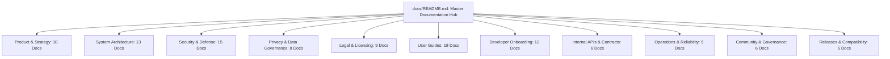

# AgentDroid Master Documentation Hub

Welcome to the official documentation ecosystem for **AgentDroid**, the production-ready multi-agent AI operating system for Android.

AgentDroid coordinates multiple specialized AI micro-agents (Phone Control, Social Media, Content Creation, Research, Communication, File Management, Productivity, Analytics, Browser, Security) using Directed Acyclic Graph (DAG) task orchestration, Android accessibility automation, and local/cloud LLM backends under a strict zero-fake-data policy.

---

## Complete Documentation Index (108 Documents)

### 1. Product & Strategy (`docs/product/` — 10 Documents)
* [Product Overview](file:///workspaces/agentdroid-/docs/product/PRODUCT_OVERVIEW.md): Executive summary, value propositions, and core differentiation.
* [Vision and Mission](file:///workspaces/agentdroid-/docs/product/VISION_AND_MISSION.md): Core vision of a sovereign, mobile-native multi-agent AI operating platform.
* [Product Requirements Document (PRD)](file:///workspaces/agentdroid-/docs/product/PRODUCT_REQUIREMENTS_DOCUMENT.md): Comprehensive functional requirements (PRD-001 to PRD-017) and NFRs.
* [Technical Requirements Document (TRD)](file:///workspaces/agentdroid-/docs/product/TECHNICAL_REQUIREMENTS_DOCUMENT.md): Technical subsystem requirements and sequence flows.
* [Feature Specification](file:///workspaces/agentdroid-/docs/product/FEATURE_SPECIFICATION.md): Feature matrix, statuses, and capabilities.
* [User Personas](file:///workspaces/agentdroid-/docs/product/USER_PERSONAS.md): Detailed user archetypes (Alex, Priya, David, Marcus).
* [User Journeys](file:///workspaces/agentdroid-/docs/product/USER_JOURNEYS.md): End-to-end journey maps for core automation workflows.
* [Product Roadmap](file:///workspaces/agentdroid-/docs/product/PRODUCT_ROADMAP.md): Horizon 1, 2, and 3 feature milestones.
* [Release Strategy](file:///workspaces/agentdroid-/docs/product/RELEASE_STRATEGY.md): Canary, Alpha, Beta, and General Availability rollout gates.
* [Requirements Traceability Matrix](file:///workspaces/agentdroid-/docs/product/REQUIREMENTS_TRACEABILITY.md): Bidirectional traceability between PRD, TRD, and code.

---

### 2. Architecture & Design (`docs/architecture/` — 13 Documents)
* [System Architecture](file:///workspaces/agentdroid-/docs/architecture/SYSTEM_ARCHITECTURE.md): High-level system topology, boundaries, and hardware interactions.
* [Software Architecture](file:///workspaces/agentdroid-/docs/architecture/SOFTWARE_ARCHITECTURE.md): Layered architecture, Clean Architecture patterns, and dependency injection.
* [Multi-Agent Architecture](file:///workspaces/agentdroid-/docs/architecture/MULTI_AGENT_ARCHITECTURE.md): Multi-agent hierarchy, communication protocols, and delegation loops.
* [Master Agent Specification](file:///workspaces/agentdroid-/docs/architecture/MASTER_AGENT.md): Central controller, prompt parsing, and task distribution engine.
* [Agent Lifecycle](file:///workspaces/agentdroid-/docs/architecture/AGENT_LIFECYCLE.md): Formal finite-state machine (FSM) from UNINITIALIZED to IDLE.
* [Task Orchestration](file:///workspaces/agentdroid-/docs/architecture/TASK_ORCHESTRATION.md): Directed Acyclic Graph (DAG) task scheduling and dependency resolution.
* [AI Provider Architecture](file:///workspaces/agentdroid-/docs/architecture/AI_PROVIDER_ARCHITECTURE.md): Pluggable HTTP engine supporting OpenAI, Gemini, Claude, and Ollama.
* [Model Routing & Fallback](file:///workspaces/agentdroid-/docs/architecture/MODEL_ROUTING.md): Cost, latency, and capability-aware model dispatching.
* [Memory Architecture](file:///workspaces/agentdroid-/docs/architecture/MEMORY_ARCHITECTURE.md): 5-tier memory model (Working, Session, Fact, Semantic, Episodic).
* [Android Integration](file:///workspaces/agentdroid-/docs/architecture/ANDROID_INTEGRATION.md): Accessibility service, IPC, and system services integration.
* [Database Schema](file:///workspaces/agentdroid-/docs/architecture/DATABASE_SCHEMA.md): Complete Room SQLite v2 database schema across 17 tables.
* [Data Flow Specification](file:///workspaces/agentdroid-/docs/architecture/DATA_FLOW.md): Sequence diagrams illustrating end-to-end event lifecycles.
* [Architecture Decision Records (ADRs)](file:///workspaces/agentdroid-/docs/architecture/ARCHITECTURE_DECISIONS.md): ADR-001 through ADR-005.

---

### 3. Security & Cyber-Defense (`docs/security/` — 15 Documents)
* [Security Overview](file:///workspaces/agentdroid-/docs/security/SECURITY_OVERVIEW.md): Core security philosophy and defense-in-depth posture.
* [Security Requirements](file:///workspaces/agentdroid-/docs/security/SECURITY_REQUIREMENTS.md): Formal security specifications (SEC-001 to SEC-010).
* [STRIDE Threat Model](file:///workspaces/agentdroid-/docs/security/THREAT_MODEL.md): STRIDE threat analysis across 10 threat scenarios.
* [Attack Surface Analysis](file:///workspaces/agentdroid-/docs/security/ATTACK_SURFACE_ANALYSIS.md): Comprehensive inventory of physical, network, and IPC vectors.
* [Trust Boundaries](file:///workspaces/agentdroid-/docs/security/TRUST_BOUNDARIES.md): Isolation barriers between app sandbox, Keystore, and external APIs.
* [Permission Model](file:///workspaces/agentdroid-/docs/security/PERMISSION_MODEL.md): Android runtime permissions, accessibility privileges, and principle of least privilege.
* [Credential Management](file:///workspaces/agentdroid-/docs/security/CREDENTIAL_MANAGEMENT.md): Hardware-backed Android Keystore and AES-256 GCM storage.
* [Prompt Injection Defense](file:///workspaces/agentdroid-/docs/security/PROMPT_INJECTION_DEFENSE.md): Multi-layer defenses against direct and indirect prompt injections.
* [Tool Execution Security](file:///workspaces/agentdroid-/docs/security/TOOL_EXECUTION_SECURITY.md): Action validation, Human-in-the-Loop gates, and emergency killswitches.
* [Data Protection](file:///workspaces/agentdroid-/docs/security/DATA_PROTECTION.md): Encryption at rest, in transit, and memory sanitization policies.
* [Secure Storage](file:///workspaces/agentdroid-/docs/security/SECURE_STORAGE.md): Technical implementation of Room SQLite and EncryptedSharedPreferences.
* [Network Security](file:///workspaces/agentdroid-/docs/security/NETWORK_SECURITY.md): TLS 1.3 enforcement, local subnet cleartext boundaries, and certificate pinning.
* [Incident Response Plan](file:///workspaces/agentdroid-/docs/security/INCIDENT_RESPONSE.md): Severity classification and breach handling protocols.
* [Vulnerability Reporting Protocol](file:///workspaces/agentdroid-/docs/security/VULNERABILITY_REPORTING.md): Coordinated vulnerability disclosure guidelines and PGP instructions.
* [Security Checklist](file:///workspaces/agentdroid-/docs/security/SECURITY_CHECKLIST.md): Verification matrix for production release audits.

---

### 4. Privacy & Data Governance (`docs/privacy/` — 8 Documents)
* [Privacy Overview](file:///workspaces/agentdroid-/docs/privacy/PRIVACY_OVERVIEW.md): Zero-tracker, local-first privacy commitments.
* [Data Inventory](file:///workspaces/agentdroid-/docs/privacy/DATA_INVENTORY.md): Catalog of data elements, categories, and retention lifecycles.
* [Data Collection Practices](file:///workspaces/agentdroid-/docs/privacy/DATA_COLLECTION.md): Explicit breakdown of what is collected and what is excluded.
* [Data Retention Policies](file:///workspaces/agentdroid-/docs/privacy/DATA_RETENTION.md): Retention periods, rolling purges, and automated pruning.
* [Third-Party Processors](file:///workspaces/agentdroid-/docs/privacy/THIRD_PARTY_PROCESSORS.md): Privacy terms for OpenAI, Google AI Studio, and Anthropic.
* [User Data Control](file:///workspaces/agentdroid-/docs/privacy/USER_DATA_CONTROL.md): Export, wipe, and granular memory purge procedures.
* [AI Data Processing](file:///workspaces/agentdroid-/docs/privacy/AI_DATA_PROCESSING.md): Cloud vs. local private Ollama processing models.
* [Privacy Impact Assessment (PIA)](file:///workspaces/agentdroid-/docs/privacy/PRIVACY_IMPACT_ASSESSMENT.md): Formal impact assessment and mitigation strategies.

---

### 5. Legal & Compliance (`docs/legal/` — 9 Documents)
* [Privacy Policy](file:///workspaces/agentdroid-/docs/legal/PRIVACY_POLICY.md): Production-ready legal privacy notice.
* [Terms and Conditions](file:///workspaces/agentdroid-/docs/legal/TERMS_AND_CONDITIONS.md): Complete contractual terms of service.
* [End User License Agreement (EULA)](file:///workspaces/agentdroid-/docs/legal/EULA.md): Standard mobile software license agreement.
* [Legal Disclaimer & AI Limitation](file:///workspaces/agentdroid-/docs/legal/DISCLAIMER.md): Disclaimers regarding autonomous actions and AI non-liability.
* [Acceptable Use Policy (AUP)](file:///workspaces/agentdroid-/docs/legal/ACCEPTABLE_USE_POLICY.md): Prohibited use cases, safety boundaries, and abuse terms.
* [Open Source Licenses](file:///workspaces/agentdroid-/docs/legal/OPEN_SOURCE_LICENSES.md): Full Apache 2.0 software license text.
* [Third-Party Notices](file:///workspaces/agentdroid-/docs/legal/THIRD_PARTY_NOTICES.md): Attribution for AndroidX, Jetpack Compose, OkHttp, and Room.
* [Copyright & Intellectual Property](file:///workspaces/agentdroid-/docs/legal/COPYRIGHT.md): Trademark and copyright protections.
* [Legal Review Checklist](file:///workspaces/agentdroid-/docs/legal/LEGAL_REVIEW_CHECKLIST.md): Pre-publication compliance verification guide.

---

### 6. User Guides & Manuals (`docs/user-guide/` — 18 Documents)
* [Getting Started](file:///workspaces/agentdroid-/docs/user-guide/GETTING_STARTED.md): Beginner introduction and quickstart overview.
* [Installation Guide](file:///workspaces/agentdroid-/docs/user-guide/INSTALLATION.md): Installing debug APKs and setting up emulators.
* [First Time Setup](file:///workspaces/agentdroid-/docs/user-guide/FIRST_TIME_SETUP.md): Initial permission grant, battery optimization, and accessibility setup.
* [Dashboard & Navigation Guide](file:///workspaces/agentdroid-/docs/user-guide/DASHBOARD_GUIDE.md): Navigating Command Center, Activity, and Settings.
* [Master Agent Guide](file:///workspaces/agentdroid-/docs/user-guide/MASTER_AGENT_GUIDE.md): Crafting effective goals, multi-agent workflows, and approvals.
* [Agent Fleet Management](file:///workspaces/agentdroid-/docs/user-guide/AGENT_MANAGEMENT.md): Configuring roles, toggling agents, and adjusting prompts.
* [AI Provider Setup](file:///workspaces/agentdroid-/docs/user-guide/AI_PROVIDER_SETUP.md): Connecting OpenAI, Google Gemini, Anthropic, and Groq.
* [Model Selection Guide](file:///workspaces/agentdroid-/docs/user-guide/MODEL_SELECTION.md): Dynamic model discovery and per-agent model assignment.
* [Ollama Setup Guide](file:///workspaces/agentdroid-/docs/user-guide/OLLAMA_SETUP.md): Step-by-step setup for running local models over private Wi-Fi.
* [Local LLM Setup](file:///workspaces/agentdroid-/docs/user-guide/LOCAL_LLM_SETUP.md): Integrating LM Studio, vLLM, and OpenAI-compatible endpoints.
* [Phone Automation Guide](file:///workspaces/agentdroid-/docs/user-guide/PHONE_AUTOMATION.md): Autonomous device actions, clicks, typing, and verification.
* [Accessibility Service Setup](file:///workspaces/agentdroid-/docs/user-guide/ACCESSIBILITY_SETUP.md): Enabling and troubleshooting accessibility permissions.
* [Social Media Agent Guide](file:///workspaces/agentdroid-/docs/user-guide/SOCIAL_MEDIA_GUIDE.md): Multi-platform drafting, hashtag clustering, and campaign planning.
* [Workflow Automation Guide](file:///workspaces/agentdroid-/docs/user-guide/WORKFLOW_AUTOMATION.md): Building, scheduling, and monitoring DAG pipelines.
* [Memory Management Guide](file:///workspaces/agentdroid-/docs/user-guide/MEMORY_MANAGEMENT.md): Inspecting and purging memory tiers.
* [Privacy Settings Guide](file:///workspaces/agentdroid-/docs/user-guide/PRIVACY_SETTINGS.md): Air-gapped mode, key deletion, and permission toggling.
* [Troubleshooting Guide](file:///workspaces/agentdroid-/docs/user-guide/TROUBLESHOOTING.md): Remediation steps for connection errors and timeouts.
* [Frequently Asked Questions (FAQ)](file:///workspaces/agentdroid-/docs/user-guide/FAQ.md): Answers to common questions.

---

### 7. Developer Documentation (`docs/developer/` — 12 Documents)
* [Developer Onboarding Guide](file:///workspaces/agentdroid-/docs/developer/DEVELOPER_GUIDE.md): Architecture overview and contribution workflow.
* [Development Setup](file:///workspaces/agentdroid-/docs/developer/DEVELOPMENT_SETUP.md): JDK 17, Android Studio, SDK API 34, and emulator setup.
* [Project Structure](file:///workspaces/agentdroid-/docs/developer/PROJECT_STRUCTURE.md): Code organization and package breakdown.
* [Coding Standards](file:///workspaces/agentdroid-/docs/developer/CODING_STANDARDS.md): Kotlin conventions, Compose guidelines, and coroutine scopes.
* [Agent Development Guide](file:///workspaces/agentdroid-/docs/developer/AGENT_DEVELOPMENT.md): Implementing the `Agent` interface and `BaseAgent`.
* [Custom Agent Guide](file:///workspaces/agentdroid-/docs/developer/CUSTOM_AGENT_GUIDE.md): Creating dynamic agents at runtime and persisting roles.
* [AI Provider Integration](file:///workspaces/agentdroid-/docs/developer/PROVIDER_INTEGRATION.md): Implementing custom `AiProvider` adapters.
* [Tool Development Guide](file:///workspaces/agentdroid-/docs/developer/TOOL_DEVELOPMENT.md): Adding actions to `ActionDispatcher` and `StateVerifier`.
* [Database Guide](file:///workspaces/agentdroid-/docs/developer/DATABASE_GUIDE.md): Room v2 schema, DAOs, and migration procedures.
* [Testing Guide](file:///workspaces/agentdroid-/docs/developer/TESTING_GUIDE.md): Unit testing, coroutines test, and Strict Real AI test suites.
* [Debugging & Profiling](file:///workspaces/agentdroid-/docs/developer/DEBUGGING.md): Logcat filters, Database Inspector, and network logging.
* [Build and Release Pipeline](file:///workspaces/agentdroid-/docs/developer/BUILD_AND_RELEASE.md): Gradle targets, R8 ProGuard rules, and APK signing.

---

### 8. Internal API Reference (`docs/api/` — 6 Documents)
* [API Reference Overview](file:///workspaces/agentdroid-/docs/api/API_OVERVIEW.md): Architecture of internal contracts and SDK surfaces.
* [AI Provider Interfaces](file:///workspaces/agentdroid-/docs/api/AI_PROVIDER_INTERFACES.md): Contracts for `AiProvider`, `CompletionOptions`, and `AiResponse`.
* [Agent Interfaces](file:///workspaces/agentdroid-/docs/api/AGENT_INTERFACES.md): Contracts for `Agent`, `AgentRole`, and `AgentStepResult`.
* [Tool & Action Interfaces](file:///workspaces/agentdroid-/docs/api/TOOL_INTERFACES.md): Contracts for `ActionDispatcher`, `ActionType`, and `ActionResult`.
* [Event System & Shared Context](file:///workspaces/agentdroid-/docs/api/EVENT_SYSTEM.md): Contracts for `SharedTaskContext` and `ContextEvent`.
* [Error Codes Catalog](file:///workspaces/agentdroid-/docs/api/ERROR_CODES.md): Exhaustive catalog of `ErrorCategory` and `AiError` codes.

---

### 9. Operations & SRE (`docs/operations/` — 5 Documents)
* [Backup & Restore Procedures](file:///workspaces/agentdroid-/docs/operations/BACKUP_AND_RESTORE.md): Exporting database records and Keystore considerations.
* [Logging & System Monitoring](file:///workspaces/agentdroid-/docs/operations/LOGGING_AND_MONITORING.md): Audit logging, token monitoring, and rolling retention.
* [System Performance](file:///workspaces/agentdroid-/docs/operations/PERFORMANCE.md): Cold start SLOs, Compose frame rates, and connection pooling.
* [Disaster Recovery](file:///workspaces/agentdroid-/docs/operations/DISASTER_RECOVERY.md): Emergency Killswitch procedures and database recovery.
* [Maintenance & Operations](file:///workspaces/agentdroid-/docs/operations/MAINTENANCE.md): Scheduled WorkManager tasks, VACUUM compaction, and model refresh.

---

### 10. Community & Governance (`docs/community/` — 6 Documents)
* [Contributor Guidelines](file:///workspaces/agentdroid-/docs/community/CONTRIBUTING.md): Playbook for pull requests, bug triage, and code conventions.
* [Code of Conduct](file:///workspaces/agentdroid-/docs/community/CODE_OF_CONDUCT.md): Contributor Covenant standards and enforcement procedures.
* [Project Governance](file:///workspaces/agentdroid-/docs/community/GOVERNANCE.md): Maintainer council, architectural authority, and RFC process.
* [Community Support Channels](file:///workspaces/agentdroid-/docs/community/SUPPORT.md): GitHub Discussions, Issues, and support resources.
* [Community Roadmap](file:///workspaces/agentdroid-/docs/community/ROADMAP.md): Feature horizons and community voting mechanisms.
* [Feature Requests & Proposals](file:///workspaces/agentdroid-/docs/community/FEATURE_REQUESTS.md): Evaluation criteria and proposal templates.

---

### 11. Release & Lifecycle (`docs/release/` — 5 Documents)
* [System Changelog](file:///workspaces/agentdroid-/docs/release/CHANGELOG.md): Complete release history from initial prototype to v1.0.0.
* [Software Versioning Policy](file:///workspaces/agentdroid-/docs/release/VERSIONING.md): Semantic Versioning 2.0.0 rules and build numbering.
* [Release Notes Template](file:///workspaces/agentdroid-/docs/release/RELEASE_NOTES_TEMPLATE.md): Standardized template for public release announcements.
* [Compatibility Matrix](file:///workspaces/agentdroid-/docs/release/COMPATIBILITY.md): Android API levels 26–34, ABIs, and device requirements.
* [Deprecation Policy](file:///workspaces/agentdroid-/docs/release/DEPRECATION_POLICY.md): Formal lifecycle and grace periods for retiring APIs.

---

## Static Site Generator Compatibility

The entire documentation tree is structured with standard YAML frontmatter and standard relative links, making it ready for automated publishing using modern static site generators:

* **VitePress**: Compatible out of the box with standard markdown formatting and frontmatter.
* **MkDocs (Material for MkDocs)**: Compatible; frontmatter maps cleanly to metadata navigation.
* **Docusaurus**: Compatible; supports all header tags, code fences, and Mermaid blocks.

---

## Technical Grounding & Source Code Verification

All technical descriptions, interfaces, package names, Room database tables, and error codes in this documentation correspond directly to the actual codebase at `app/src/main/java/com/agentdroid/app/`:

| Subsystem | Source Path | Verification Status |
|---|---|---|
| **Multi-Agent Orchestration** | `com.agentdroid.app.domain.orchestrator` | Verified |
| **Agent Fleet (11 Roles)** | `com.agentdroid.app.domain.agent` | Verified |
| **Action & Accessibility** | `com.agentdroid.app.automation` | Verified |
| **AI Providers & Discovery** | `com.agentdroid.app.ai` | Verified |
| **Persistence (17 Tables)** | `com.agentdroid.app.data.local` | Verified |
| **Security & Keystore** | `com.agentdroid.app.data.local.security` | Verified |
| **UI Presentation** | `com.agentdroid.app.ui` | Verified |
