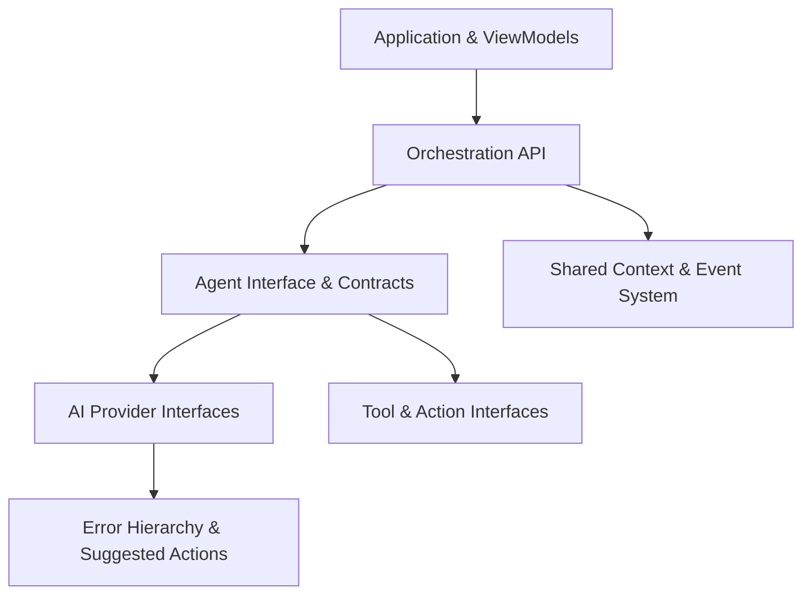

# AgentDroid Internal API Reference Overview

AgentDroid is built upon a modular set of Kotlin interfaces and abstractions. While AgentDroid runs primarily as a standalone Android application, its internal subsystems are decoupled via explicit API contracts.

---

## 1. Primary API Subsystems

1. **[AI Provider Interfaces](file:///workspaces/agentdroid-/docs/api/AI_PROVIDER_INTERFACES.md)**: Standard contracts for chat completions, streaming responses, and dynamic model discovery.
2. **[Agent Interfaces](file:///workspaces/agentdroid-/docs/api/AGENT_INTERFACES.md)**: Contracts defining agent roles, task execution steps, lifecycle events, and results.
3. **[Tool Interfaces](file:///workspaces/agentdroid-/docs/api/TOOL_INTERFACES.md)**: Device automation tools, action parameters, return values, and state verification.
4. **[Event & Context System](file:///workspaces/agentdroid-/docs/api/EVENT_SYSTEM.md)**: Reactive event bus, task state sharing, and inter-agent memory communication.
5. **[Error Codes Catalog](file:///workspaces/agentdroid-/docs/api/ERROR_CODES.md)**: Standardized error categories, error codes, and automated remediation actions.

---

## 2. Serialization & Wire Formats

* **JSON Serialization**: AgentDroid uses `kotlinx.serialization.json` for all internal model exchange, task serialization, and REST communication.
* **Deterministic Parsing**: When LLMs return JSON plans or tool arguments, schemas are validated against typed Kotlin data classes.
* **Null Safety**: All API contracts enforce non-null values with optional fields marked explicitly with `?`.

---

## Related Documentation
* [Developer Guide](file:///workspaces/agentdroid-/docs/developer/DEVELOPER_GUIDE.md)
* [Software Architecture](file:///workspaces/agentdroid-/docs/architecture/SOFTWARE_ARCHITECTURE.md)
