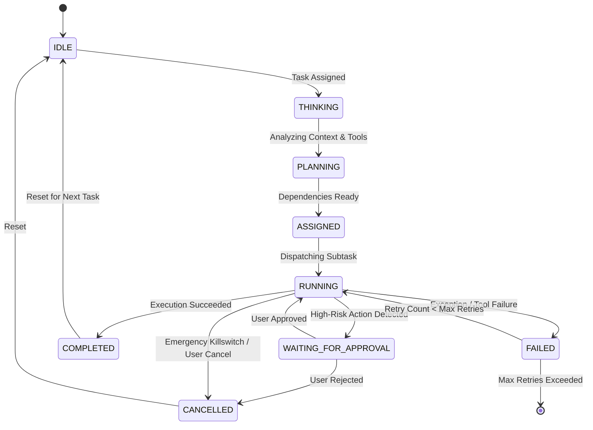

# Agent Lifecycle

## State Machine Specification

Every agent in AgentDroid transitions through a deterministic state machine defined by `AgentExecutionState`:

---

## State Transition Definitions

| State | Definition | Trigger / Condition |
| :--- | :--- | :--- |
| **`IDLE`** | Agent is unallocated, listening for orchestrator events. | System start or completion of previous plan. |
| **`THINKING`** | Agent is parsing natural language instructions or prompt. | Received `TaskItem` from `AgentOrchestrator`. |
| **`PLANNING`** | Agent is resolving required tools and inspecting `SharedTaskContext`. | Context retrieved from memory and DAG. |
| **`ASSIGNED`** | Task dependencies are verified complete; task is queued for dispatch. | Upstream DAG tasks report `COMPLETED`. |
| **`RUNNING`** | Actively executing AI inference or native Android system action. | Dispatcher invokes `performTaskExecution()`. |
| **`WAITING_FOR_APPROVAL`**| Task paused awaiting user biometric or click confirmation. | `riskLevel == RiskLevel.HIGH` detected. |
| **`COMPLETED`** | Subtask finished successfully; output data committed to context. | Tool execution returned valid result. |
| **`FAILED`** | Action or inference failed with an error. | API error, timeout, or missing element. |
| **`CANCELLED`** | Execution aborted prior to natural completion. | User veto, killswitch, or parent plan cancel. |

---

## Concurrency & Cancellation Mechanics

1. **Structured Concurrency**: Each agent task executes within a child `CoroutineScope` bound to the parent `AgentOrchestrator` execution job.
2. **Immediate Cancellation**: Calling `agent.cancel()` cancels the underlying `Job`, resets internal state flows to `IDLE`, and records an abort log in `ActivityLogDao`.
3. **Emergency Stop**: If `EmergencyKillswitch.triggerEmergencyStop()` is engaged, all state checks throw `SecurityException`, instantly aborting all running coroutine scopes across all agents simultaneously.
