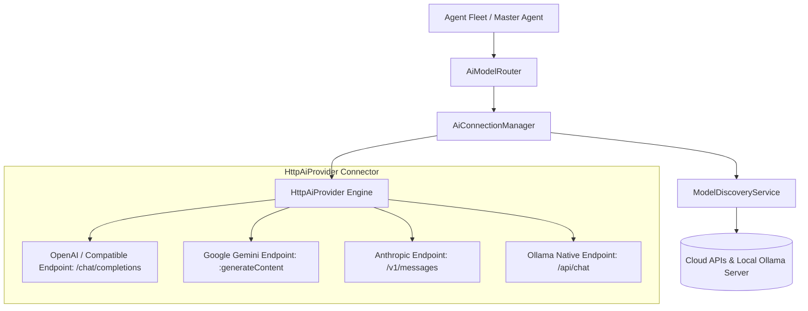

# AI Provider Architecture

## Architecture Overview

AgentDroid isolates AI model vendors behind a modular abstraction layer (`com.agentdroid.app.ai`), decoupling agent business logic from specific provider SDKs or API schemas:

---

## 12-State Connection Lifecycle

`AiConnectionManager` manages the genuine connection state for every configured provider:

| Connection State | Semantics |
| :--- | :--- |
| **`NOT_CONFIGURED`** | No API credentials configured, or provider disabled in settings. |
| **`CONFIGURED`** | API key is present in Keystore, but network ping has not yet confirmed reachability. |
| **`CONNECTING`** | Actively performing TLS handshake, authentication check, or model discovery. |
| **`CONNECTED`** | Verified active connection; discovery or inference succeeded with HTTP 200. |
| **`AUTHENTICATION_FAILED`**| Remote API returned HTTP 401 or 403 (invalid Bearer token). |
| **`INVALID_API_KEY`** | Provider explicitly confirmed API key format is invalid or expired. |
| **`MODEL_NOT_FOUND`** | Target model ID does not exist on provider (HTTP 404). |
| **`RATE_LIMITED`** | Rate limit or quota exceeded (HTTP 429). |
| **`NETWORK_ERROR`** | DNS resolution failed or socket closed prematurely. |
| **`PROVIDER_UNAVAILABLE`** | Vendor experiencing outages or 5xx internal server errors. |
| **`REQUEST_TIMEOUT`** | Network request exceeded 15-second connect / 60-second read deadline. |
| **`UNKNOWN_ERROR`** | Unrecognized payload structure or JSON parsing exception. |

---

## Dynamic Model Discovery Engine

`ModelDiscoveryService` dynamically discovers models directly from vendor endpoints:
* **OpenAI**: `GET https://api.openai.com/v1/models` (Bearer Token)
* **Google Gemini**: `GET https://generativelanguage.googleapis.com/v1beta/models?key={key}`
* **Anthropic**: `GET https://api.anthropic.com/v1/models` (`x-api-key`, `anthropic-version: 2023-06-01`)
* **OpenRouter**: `GET https://openrouter.ai/api/v1/models` (Bearer Token)
* **Groq**: `GET https://api.groq.com/openai/v1/models` (Bearer Token)
* **Together AI**: `GET https://api.together.xyz/v1/models` (Bearer Token)
* **Ollama**: `GET http://<host>:11434/api/tags`
* **Custom Inference**: `GET /v1/models` (LM Studio, vLLM, LocalAI, llama.cpp)

Discovered models are persisted in the Room `discovered_models` table with contextual capabilities (`TOOL_CALLING`, `VISION`, `REASONING`) and context windows.
