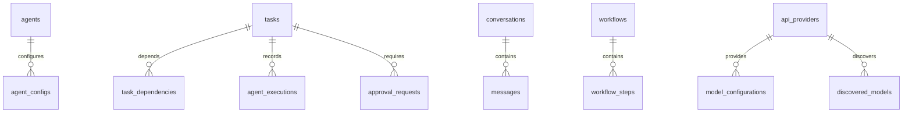

# Database Schema (Room Database v2)

AgentDroid utilizes an embedded SQLite database managed by Android Room (`version = 2`), located at `/data/data/com.agentdroid.app/databases/agentdroid.db`.

---

## Complete Table Specifications

### 1. `agents`
* `id` (TEXT, PK): Unique agent identifier (e.g. `agent_master`, `agent_phone`).
* `name` (TEXT): Display name.
* `role` (TEXT): Enum string matching `AgentRole`.
* `description` (TEXT): System capability summary.
* `isEnabled` (INTEGER): Boolean flag (1=enabled, 0=disabled).
* `customSystemPrompt` (TEXT, Nullable): Optional user prompt override.
* `createdAt` (INTEGER): Timestamp in milliseconds.

### 2. `tasks`
* `id` (TEXT, PK): Unique task ID (e.g. `task_plan1_1`).
* `planId` (TEXT, Index): Parent orchestration plan ID.
* `agentRole` (TEXT): Role assigned to execute task.
* `title` (TEXT): Short descriptive title.
* `description` (TEXT): Execution instructions.
* `status` (TEXT): `PENDING`, `RUNNING`, `COMPLETED`, `FAILED`, `CANCELLED`, `SKIPPED`.
* `riskLevel` (TEXT): `LOW`, `MEDIUM`, `HIGH`.
* `actionType` (TEXT): Action type matching `ActionType`.
* `retryCount` (INTEGER): Number of execution attempts.
* `maxRetries` (INTEGER): Maximum permitted retries (default 3).
* `outputDataJson` (TEXT): Serialized output map.
* `error` (TEXT, Nullable): Error message if failed.
* `startTime` / `endTime` (INTEGER, Nullable): Execution epoch timestamps.

### 3. `task_dependencies`
* `id` (INTEGER, PK, Auto): Row ID.
* `taskId` (TEXT, FK $\rightarrow$ `tasks.id`, Cascade Delete): Dependent task.
* `dependsOnTaskId` (TEXT, Index): Required upstream task.

### 4. `api_providers`
* `id` (TEXT, PK): Provider ID (e.g. `prov_openai`, `prov_ollama`).
* `providerType` (TEXT): `OPENAI`, `GEMINI`, `ANTHROPIC`, `OPENROUTER`, `GROQ`, `TOGETHER`, `OLLAMA`, `OPENAI_COMPATIBLE`.
* `displayName` (TEXT): Display name.
* `baseUrl` (TEXT): Inference endpoint URL.
* `isEnabled` (INTEGER): Boolean active flag.
* `totalTokensUsed` (INTEGER): Cumulative token counter.

### 5. `discovered_models`
* `id` (TEXT, PK): Composite key (`{providerId}:{modelId}`).
* `modelId` (TEXT, Index): Provider model ID string (e.g. `gpt-4o`, `llama3.2`).
* `providerId` (TEXT, Index): Foreign provider ID.
* `displayName` (TEXT): Formatted name.
* `modelType` (TEXT): `CLOUD` or `LOCAL`.
* `capabilitiesJson` (TEXT): JSON array of `ModelCapability` enum strings.
* `contextWindow` (INTEGER, Nullable): Maximum context tokens.
* `isAvailable` (INTEGER): Availability flag.
* `isLocal` (INTEGER): Local LAN flag.
* `lastVerified` (INTEGER): Verification epoch timestamp.
* `isManualEntry` (INTEGER): Boolean flag (1=user manually typed, 0=discovered).
* `isCached` (INTEGER): Boolean flag (1=cached catalog, 0=live verified).

### 6. `model_configurations`
* `id` (TEXT, PK): Config ID (e.g. `cfg_phone`, `cfg_master`).
* `agentRole` (TEXT, Unique Index): Associated agent role string or `GLOBAL_DEFAULT`.
* `providerId` (TEXT): Target provider ID.
* `modelName` (TEXT): Target model ID.
* `temperature` (REAL): Sampling temperature (0.0 - 2.0).
* `maxTokens` (INTEGER): Completion token budget.

### 7. `memory_records`
* `id` (TEXT, PK): Unique UUID.
* `tier` (TEXT, Index): `WORKING`, `SHORT_TERM`, `LONG_TERM`, `EPISODIC`, `PROCEDURAL`.
* `agentRole` (TEXT, Index, Nullable): Optional role ownership.
* `key` (TEXT, Index): Memory key identifier.
* `value` (TEXT): Memory content.
* `tagsJson` (TEXT): JSON array of string tags.
* `confidence` (REAL): Confidence score (0.0 - 1.0).
* `timestamp` (INTEGER): Insertion epoch.
* `accessCount` (INTEGER): Frequency access counter.

### 8. `approval_requests`
* `id` (TEXT, PK): Request UUID.
* `taskId` (TEXT, Index): Associated task.
* `planId` (TEXT): Associated plan.
* `agentRole` (TEXT): Requesting agent.
* `title` / `description` (TEXT): Proposed action summary.
* `riskLevel` (TEXT): Risk tier (`HIGH`).
* `actionDetails` (TEXT): Technical payload parameters.
* `targetPayload` (TEXT, Nullable): Target URL, email, or package.
* `status` (TEXT, Index): `PENDING`, `APPROVED`, `REJECTED`, `EXPIRED`.
* `timestamp` (INTEGER): Creation epoch.

### 9. Additional Tables
* `conversations` / `messages`: Chat history, roles (`USER`, `MASTER`), prompts.
* `workflows` / `workflow_steps`: Automation templates, cron schedules, step ordering.
* `connected_accounts`: Social accounts (`TWITTER`, `LINKEDIN`), sync times.
* `permissions`: Per-role Android permission grants.
* `activity_logs`: Audit trail of all actions, errors, and parameters.
