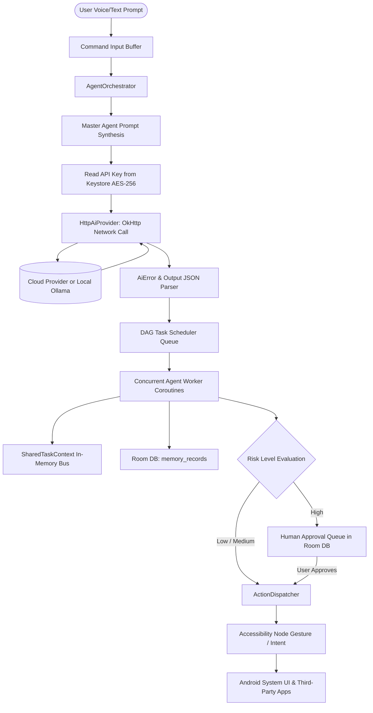

# Data Flow Architecture

## Inbound Prompt to Execution Data Pipeline

---

## Data Boundary Analysis

1. **Memory Boundaries**:
   * Prompts and streaming chunks are held in temporary memory during active sessions.
   * `SharedTaskContext` retains inter-task state only during the active `planId` lifecycle.
2. **Persistence Boundaries**:
   * API credentials are encrypted with hardware-backed AES-256 GCM in `EncryptedSharedPreferences`. They are never stored in Room SQLite.
   * Chat messages, activity logs, and memory records reside exclusively on local device storage (`/data/data/com.agentdroid.app/databases/agentdroid.db`).
3. **Egress Boundaries**:
   * Egress traffic is restricted solely to the Base URL of the configured AI provider.
   * Remote endpoints enforce TLS (`HTTPS`). Cleartext HTTP is permitted only for verified local subnets (`localhost`, `10.0.2.2`, `192.168.0.0/16`, `10.0.0.0/8`, `172.16.0.0/12`).
   * No telemetry, crash analytics, or user prompts are ever sent to AgentDroid developers or third-party tracking networks.
