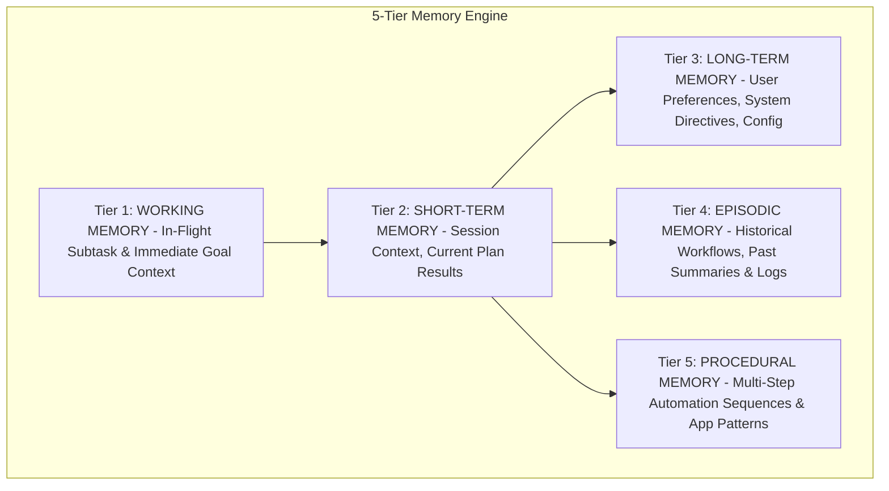

# Memory Architecture

## 5-Tier Memory Model

To prevent context window saturation while maintaining long-term personalization, AgentDroid segments memory into 5 distinct architectural tiers:



---

## Memory Tier Specifications

| Tier | Enum Value | Retention Policy | Typical Content | Purge Control |
| :--- | :--- | :--- | :--- | :--- |
| **Working Memory** | `WORKING` | Discarded upon subtask completion | Step-by-step intermediate variables, scratchpad tokens | Automatic |
| **Short-Term Memory**| `SHORT_TERM` | Cleared at end of session or plan | Output summaries of preceding DAG tasks in active plan | User reset / Session end |
| **Long-Term Memory** | `LONG_TERM` | Persistent until explicit user deletion | User preferred tone, author names, default hashtags | User "Reset" in Settings |
| **Episodic Memory** | `EPISODIC` | Persistent with LRU compaction | Previous days' research briefs, executed workflow histories | User "Reset" in Settings |
| **Procedural Memory**| `PROCEDURAL` | Persistent learned UI patterns | UI element identifiers, app launch patterns, navigation sequences | User "Reset" in Settings |

---

## Retrieval & Confidence Weighting

Memory records are persisted in the Room `memory_records` table:

```kotlin
@Entity(tableName = "memory_records", indices = [Index("tier"), Index("key"), Index("agentRole")])
data class MemoryRecordEntity(
    @PrimaryKey val id: String,
    val tier: String,
    val agentRole: String?,
    val key: String,
    val value: String,
    val tagsJson: String = "[]",
    val confidence: Float = 1.0f,
    val timestamp: Long = System.currentTimeMillis(),
    val accessCount: Int = 0
)
```

When an agent requests context via `AgentMemoryManager.getMemoryContextForAgent(role)`:
1. Queries records matching `agentRole == role` or `agentRole IS NULL` (global memories).
2. Increments `accessCount` to reward frequently utilized memories.
3. Formats memory entries into concise key-value briefing blocks injected into the agent's system prompt.
4. Users retain full sovereign control and can purge any individual tier or purge all records instantaneously from **Settings $\rightarrow$ Multi-Tier Context Memory**.
