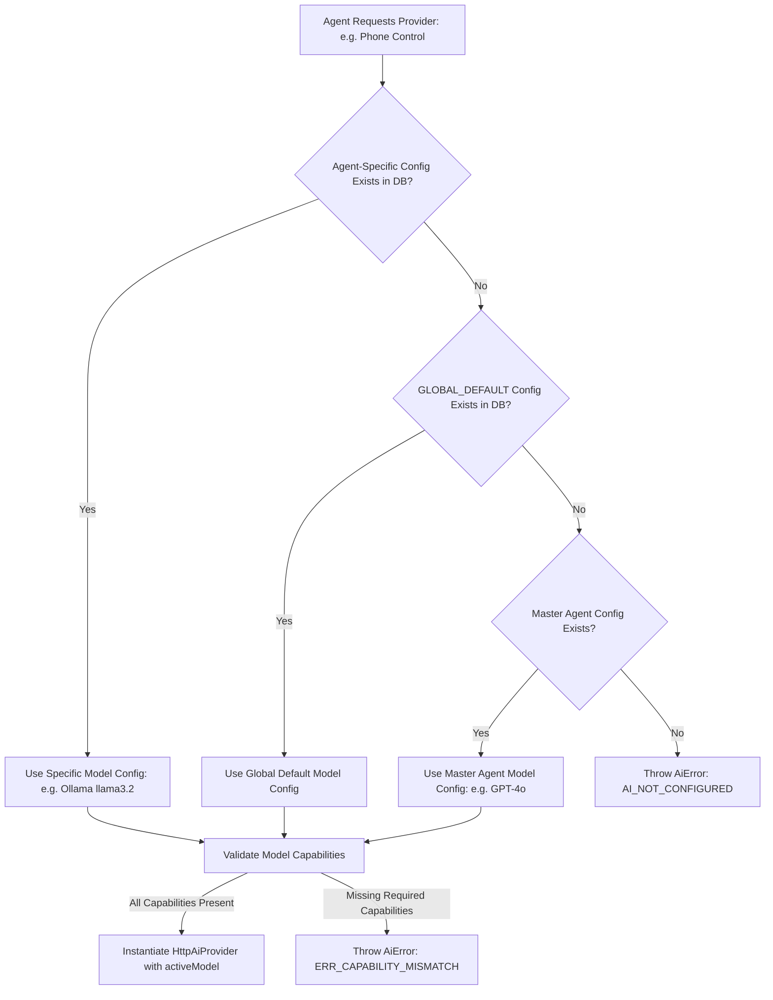

# Model Routing & Capability Validation

## Model Resolution Strategy

When an agent requests an AI provider instance, `AiConnectionManager.validateAndGetProvider(role)` resolves the target model through a prioritized three-step fallback hierarchy:

---

## Agent Capability Matching Rules

Agent roles require distinct capability sets defined in `com.agentdroid.app.domain.model.ModelCapability`:

| Agent Role | Required Model Capabilities | Failure Consequence if Missing |
| :--- | :--- | :--- |
| **`MASTER`** | `TEXT_GENERATION`, `STRUCTURED_OUTPUT`, `REASONING` | Cannot output valid JSON subtask arrays; goal decomposition fails. |
| **`PHONE_CONTROL`**| `TEXT_GENERATION`, `TOOL_CALLING`, `REASONING` | Cannot map UI accessibility node IDs to action gestures. |
| **`RESEARCH`** | `TEXT_GENERATION`, `TOOL_CALLING` | Cannot invoke search tools or structured intelligence extractors. |
| **`CONTENT_CREATION`**| `TEXT_GENERATION` | Basic text models permitted; high creativity and tone adherence required. |
| **`SOCIAL_MEDIA`**| `TEXT_GENERATION`, `STRUCTURED_OUTPUT` | Cannot format multi-platform JSON metadata and post scheduling dates. |
| **`SECURITY`** | `TEXT_GENERATION`, `REASONING` | Cannot perform deep AST and Android permission security audits. |

If a user assigns a model lacking required capabilities, `AiConnectionManager` rejects execution with an actionable error:
> *"Model 'basic-text' lacks required capabilities for Phone Control Agent: Tool Calling. Select a model supporting Tool Calling in Settings $\rightarrow$ Model Picker."*
