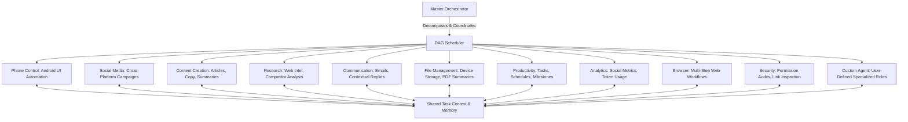

# Multi-Agent Architecture

## Agent Specialization Model

AgentDroid avoids the monolithic "one-size-fits-all" model approach. Instead, operations are divided among 11 distinct agent roles:



---

## Agent Fleet Catalog

| Agent Role | Role ID | Implementation Class | System Capabilities | Tool Suite |
| :--- | :--- | :--- | :--- | :--- |
| **MASTER** | `agent_master` | `MasterAgent.kt` | Intent classification, task decomposition, dependency graphing, report synthesis | `GoalDecomposer`, `ReportSynthesizer`, `AgentCoordinator` |
| **PHONE_CONTROL** | `agent_phone` | `PhoneControlAgent.kt` | Native Android UI clicks, typing, scrolling, view inspection, intent launching | `AccessibilityDriver`, `IntentLauncher`, `ScreenInspector`, `StateVerifier` |
| **SOCIAL_MEDIA** | `agent_social` | `SocialMediaAgent.kt` | X, LinkedIn, Instagram, Facebook, Reddit, YouTube, Telegram, Discord management | `SocialComposer`, `HashtagEngine`, `CalendarOrganizer`, `ThreadBuilder` |
| **CONTENT_CREATION**| `agent_content`| `ContentCreationAgent.kt`| Long-form articles, ad copy, captions, document summaries, tone conversion | `ArticleWriter`, `MarketingStrategist`, `CopyDrafter`, `ToneTransformer` |
| **RESEARCH** | `agent_research`| `ResearchAgent.kt` | Structured web intelligence, competitor analyses, topic briefings, citation indexing | `WebCrawler`, `CompetitorAnalyzer`, `FactChecker`, `CitationIndexer` |
| **COMMUNICATION** | `agent_comm` | `CommunicationAgent.kt` | Email drafting, contextual message triage, notification parsing, reply suggestions | `EmailComposer`, `MessageSynthesizer`, `NotificationParser`, `ThreadAnalyzer` |
| **FILE_MANAGEMENT** | `agent_file` | `FileManagementAgent.kt` | Device storage scans, duplicate detection, document categorization, PDF parsing | `StorageScanner`, `DocClassifier`, `DuplicateDetector`, `PdfSummarizer` |
| **PRODUCTIVITY** | `agent_productivity`| `ProductivityAgent.kt` | Daily agenda organization, calendar scheduling, project task tracking, reminders | `ScheduleOptimizer`, `CalendarSync`, `TaskPrioritizer`, `ReminderManager` |
| **ANALYTICS** | `agent_analytics`| `AnalyticsAgent.kt` | Social metrics aggregation, campaign performance tracking, token cost audits | `EngagementAnalyzer`, `TrendTracker`, `RoiCalculator`, `TokenAuditor` |
| **BROWSER** | `agent_browser` | `BrowserAgent.kt` | Autonomous browser navigation, DOM extraction, form submission, web intelligence | `BrowserDriver`, `DomParser`, `FormSubmitter`, `ContentExtractor` |
| **SECURITY** | `agent_security` | `SecurityAgent.kt` | Android app permission audits, link safety inspection, phishing defense, policy enforcement | `PermissionAuditor`, `LinkInspector`, `PhishingDetector`, `PolicyEnforcer` |
| **CUSTOM** | `agent_custom` | `CustomAgent.kt` | Dynamic user-configured prompts, capabilities, and parameters | User-configured tools |

---

## Inter-Agent Communication: SharedTaskContext

Agents do not invoke one another directly via tight coupling. Instead, collaboration occurs through the thread-safe `SharedTaskContext`:

```kotlin
class SharedTaskContext(private val planId: String) {
    private val data = ConcurrentHashMap<String, String>()
    private val _events = MutableSharedFlow<ContextEvent>(replay = 100)
    val events: SharedFlow<ContextEvent> = _events.asSharedFlow()

    suspend fun put(key: String, value: String, producerAgent: AgentRole) {
        data[key] = value
        _events.emit(ContextEvent.DataAdded(key, value, producerAgent))
    }

    fun get(key: String): String? = data[key]
    fun getAll(): Map<String, String> = data.toMap()
}
```

When `ResearchAgent` completes competitor intelligence, it writes `research_brief` into `SharedTaskContext`. When `ContentCreationAgent` executes downstream, it retrieves `research_brief` from context to craft aligned copy.
