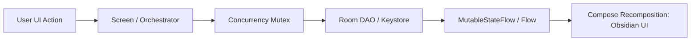

# Software Architecture

## Package Organization

AgentDroid is organized under `com.agentdroid.app` following clean architecture principles:

```text
com.agentdroid.app
├── AgentDroidApplication.kt       # Application singleton & dependency initialization
├── MainActivity.kt                # Single Activity host with Jetpack Navigation
├── ai/
│   ├── client/                    # Real HTTP provider implementations (HttpAiProvider)
│   ├── connection/                # Connection manager, states, and network security validation
│   ├── discovery/                 # Dynamic model discovery service (cloud & Ollama)
│   ├── error/                     # Unified AiError taxonomy, sanitization, and actions
│   ├── provider/                  # Core AiProvider interfaces and data models
│   └── router/                    # Per-agent model routing and fallback resolution
├── automation/
│   ├── accessibility/             # Android Accessibility Service driver & node traversal
│   ├── action/                    # ActionDispatcher, StateVerifier, EmergencyKillswitch
│   └── service/                   # AutomationForegroundService with notification controls
├── data/
│   └── local/
│       ├── dao/                   # Room Data Access Objects (10 DAO interfaces)
│       ├── database/              # AgentDroidDatabase v2 & seed callbacks
│       ├── entity/                # 17 Room SQLite entity definitions
│       └── preferences/           # Android Keystore EncryptedSharedPreferences manager
├── domain/
│   ├── agent/                     # Agent contract, BaseAgent, MasterAgent, and 10 specialized agents
│   ├── memory/                    # 5-Tier AgentMemoryManager
│   ├── model/                     # Domain data models (TaskItem, TaskPlan, AgentRole, MemoryTier)
│   ├── orchestrator/              # DAGScheduler, AgentOrchestrator, SharedTaskContext
│   └── workflow/                  # WorkflowEngine and WorkManager AgentDroidWorker
├── sdk/                           # PluginRegistry, AgentPlugin, and sample extensions
└── ui/
    ├── components/                # Reusable Obsidian UI components, command bars, hero cards
    ├── navigation/                # Screen definitions and 5-destination bottom nav list
    ├── screens/                   # Compose screens (Dashboard, Command, Agents, Automation, Activity, Settings)
    └── theme/                     # Obsidian Black theme, colors, typography, shapes
```

---

## State Management Pattern

The application utilizes declarative state management with Kotlin Coroutines and Jetpack Compose:



1. **State Exposure**: Internal mutability is encapsulated (`MutableStateFlow<T>`) while exposing read-only public states (`StateFlow<T>`).
2. **Lifecycle Awareness**: Composables collect state using `collectAsState()` or `collectAsStateWithLifecycle()`.
3. **Database Streaming**: Room DAO queries return Kotlin `Flow<List<T>>`, ensuring instantaneous UI updates when records mutate.
