# System Architecture

## Architectural Philosophy

AgentDroid is built upon five foundational architectural tenets:
1. **Unidirectional Data Flow (UDF)**: UI states are driven by reactive Kotlin `StateFlow` streams originating from Single Sources of Truth (Room DB, `AiConnectionManager`, `AgentOrchestrator`).
2. **Modular Layer Decoupling**: UI composables never execute network requests or raw SQLite queries directly; interactions pass through the Orchestrator, Repository, and DAOs.
3. **Hardware-Enforced Security**: Critical credentials never touch unencrypted SQLite or SharedPreferences. Keys are wrapped using Android Keystore MasterKey AES-256 GCM.
4. **Resilient Failure Boundaries**: Task execution is modeled as a Directed Acyclic Graph (DAG) with dependency isolation. A failure in an analytics task does not collapse research tasks.
5. **Zero-Trust AI Execution**: AI outputs are parsed as untrusted inputs, sanitized for prompt injection, validated for JSON schemas, and vetted through risk assessment before triggering native Android OS calls.

---

## High-Level System Architecture Diagram

```mermaid
graph TB
    subgraph Client_Presentation [Client Presentation Layer]
        AppUI[Jetpack Compose UI: Obsidian Dark]
        Nav[Navigation Graph: 5 Destinations]
        HeroCard[MasterAgentHeroCard]
        AppUI --> Nav
        AppUI --> HeroCard
    end

    subgraph Orchestration_Core [Agent Orchestration Core]
        Master[Master Agent]
        Orchestrator[Agent Orchestrator]
        DAGEngine[DAG Task Scheduler]
        TaskBus[SharedTaskContext Event Bus]
        
        Orchestrator --> Master
        Orchestrator --> DAGEngine
        Orchestrator --> TaskBus
    end

    subgraph Agent_Fleet [Specialized Agent Fleet]
        PCA[Phone Control Agent]
        SMA[Social Media Agent]
        CCA[Content Creation Agent]
        RA[Research Agent]
        CA[Communication Agent]
        FMA[File Management Agent]
        PDA[Productivity Agent]
        AA[Analytics Agent]
        BA[Browser Agent]
        SA[Security Agent]
        CAB[Custom Agent Builder]
        
        TaskBus <--> PCA & SMA & CCA & RA & CA & FMA & PDA & AA & BA & SA & CAB
    end

    subgraph Android_Bridge [Native Android System Bridge]
        AccService[AgentDroid Accessibility Service]
        FgService[Automation Foreground Service]
        Dispatcher[Action Dispatcher]
        Verifier[State Verifier]
        Killswitch[Emergency Killswitch]
        
        PCA --> Dispatcher
        Dispatcher --> AccService
        Dispatcher --> Verifier
        FgService --> Killswitch
    end

    subgraph AI_Infrastructure [AI Connectivity & Registry Layer]
        Router[AI Model Router]
        ConnMgr[AI Connection Manager]
        Discovery[Model Discovery Service]
        HttpAi[HttpAiProvider Engine]
        NetSec[Network Security Validator]
        
        Router --> ConnMgr
        ConnMgr --> Discovery
        ConnMgr --> HttpAi
        Discovery --> NetSec
    end

    subgraph Inference_Endpoints [Inference Endpoints: Cloud & Local]
        OpenAI[OpenAI / GPT-4o]
        Gemini[Google Gemini 1.5 Pro]
        Claude[Anthropic Claude 3.5]
        Groq[Groq LPU Cloud]
        OpenRouter[OpenRouter Gateway]
        Together[Together AI]
        Ollama[Local Ollama LAN Server]
        LMStudio[LM Studio / LocalAI Server]
        
        HttpAi --> OpenAI & Gemini & Claude & Groq & OpenRouter & Together & Ollama & LMStudio
    end

    subgraph Storage_Security [Local Storage & Security Layer]
        RoomDB[(Room Database v2: 17 Tables)]
        Keystore[Android Keystore AES-256 GCM]
        Memory[5-Tier Memory Manager]
        
        Orchestrator --> RoomDB
        ConnMgr --> RoomDB
        ConnMgr --> Keystore
        Agent_Fleet --> Memory
        Memory --> RoomDB
    end

    Client_Presentation --> Orchestration_Core
    Orchestration_Core --> AI_Infrastructure
    Orchestration_Core --> Android_Bridge
```

