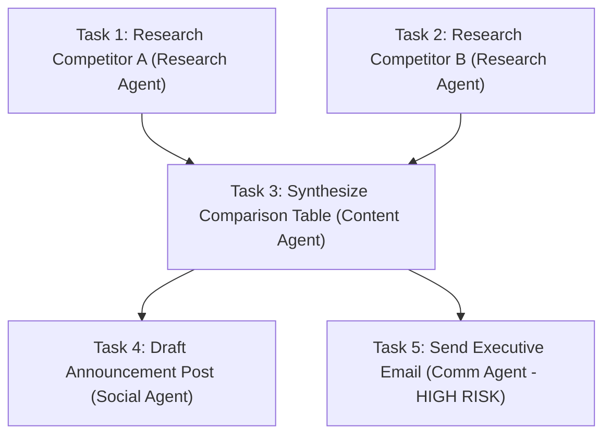

# Task Orchestration & DAG Engine

## Directed Acyclic Graph (DAG) Scheduling

AgentDroid schedules multi-agent workloads using topological sorting over a Directed Acyclic Graph. Tasks are represented as `TaskItem` nodes, connected by directional dependency edges (`dependsOn`).



In the example above:
* **Task 1** and **Task 2** have empty `dependsOn` lists. `DAGScheduler.getReadyTasks()` marks them both ready simultaneously, launching them **concurrently in parallel coroutines**.
* **Task 3** depends on `[Task 1, Task 2]`. It remains in `PENDING` status until both Task 1 and Task 2 report `COMPLETED`.
* **Task 4** and **Task 5** depend on `[Task 3]`. Once Task 3 completes, Task 4 and Task 5 launch in parallel.

---

## Failure Propagation & Dependency Skipping

If a critical task fails and exhausts its maximum retries (`retryCount >= maxRetries`):
1. `DAGScheduler.hasUnrecoverableFailure()` evaluates to `true`.
2. `DAGScheduler.markSkippedTasks()` traverses downstream nodes that transitively depend on the failed node.
3. Downstream tasks are automatically transitioned to `SKIPPED` with the error: `"Dependency failed or skipped."`
4. Independent branches in the DAG continue executing unaffected.

---

## Concurrency Control: Mutex Synchronization

To prevent race conditions during rapid state transitions, `AgentOrchestrator` guards task status updates and graph evaluations with a reentrant Kotlin `Mutex`:

```kotlin
mutex.withLock {
    val readyTasks = dagScheduler.getReadyTasks(currentTasks)
    for (task in readyTasks) {
        launchTask(task)
    }
}
```

This guarantees that multiple agents completing tasks concurrently cannot corrupt the shared plan state in Room or duplicate task dispatches.
