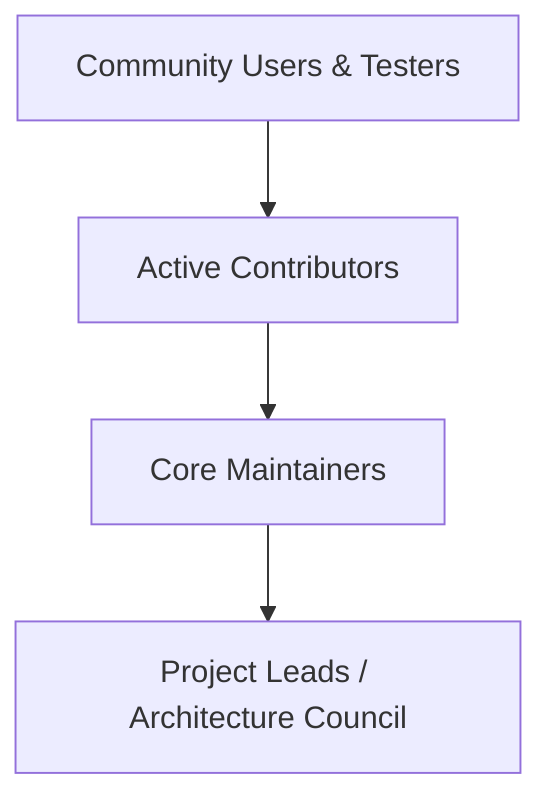

# Project Governance & Maintainer Model

This document outlines the governance structure and decision-making framework for the AgentDroid open-source project.

---

## 1. Governance Principles

AgentDroid is operated as a meritocratic, community-driven open-source initiative:
* **Transparency**: Architectural discussions, RFCs, and roadmap planning occur openly in GitHub Issues and Discussions.
* **Consensus**: Technical disputes are resolved through architectural review and consensus-building among core maintainers.
* **Safety & Security First**: Changes affecting permissions, Keystore encryption, or device safety hold veto authority by designated security maintainers.

---

## 2. Roles & Responsibilities

* **Project Leads**: Set long-term product vision, manage signing credentials, and publish official release binaries.
* **Core Maintainers**: Review and merge pull requests, triage issues, manage branch releases, and oversee architecture.
* **Contributors**: Submit code improvements, test releases, report bugs, and write documentation.
* **Community Members**: File issues, test local LLM setups, participate in discussions, and vote on feature requests.

---

## 3. Decision-Making Process

* Minor fixes and non-breaking enhancements: Single maintainer approval.
* Significant architectural changes (ADRs), new permissions, or database schema alterations: Minimum of two core maintainer approvals.

---

## Related Documentation
* [Contributor Guidelines](file:///workspaces/agentdroid-/docs/community/CONTRIBUTING.md)
* [Community Roadmap](file:///workspaces/agentdroid-/docs/community/ROADMAP.md)
