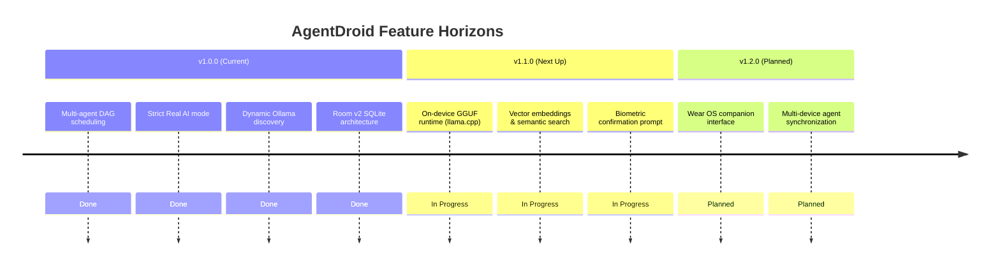

# Community Roadmap & Feature Voting

This document outlines key feature tracks actively prioritized for development and explains how community members can propose and vote on future initiatives.

---

## 1. Feature Tracks in Active Development

---

## 2. Community Voting Mechanism

1. Feature proposals are posted under GitHub Discussions → **Ideas & Feature Requests**.
2. Community members cast votes using the GitHub **Thumbs Up (👍)** reaction.
3. Monthly triage reviews elevate top-voted proposals into the official milestone backlog.

---

## Related Documentation
* [Product Roadmap](file:///workspaces/agentdroid-/docs/product/PRODUCT_ROADMAP.md)
* [Feature Requests](file:///workspaces/agentdroid-/docs/community/FEATURE_REQUESTS.md)
