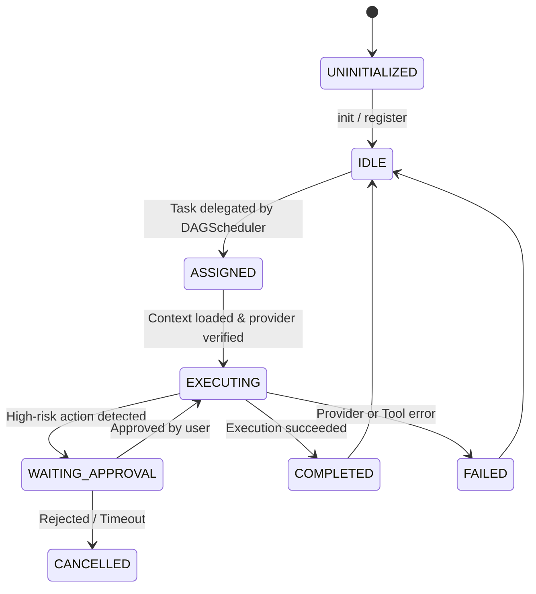

# Agent Development & Extension Guide

In AgentDroid, every agent is an autonomous software component that satisfies the `Agent` interface or extends `BaseAgent`.

---

## 1. The `Agent` Interface Contract

Every agent implementation must provide identity, capability descriptors, and an asynchronous execution method:

```kotlin
interface Agent {
    val id: String
    val role: AgentRole
    val name: String
    val description: String
    val capabilities: List<String>
    val status: AgentStatus

    suspend fun executeTask(
        task: AgentTask,
        context: SharedTaskContext
    ): AgentStepResult

    suspend fun terminate()
}
```

---

## 2. Implementing an Agent via `BaseAgent`

`BaseAgent` provides common boilerplate including telemetry recording, prompt interpolation, and structured error handling:

```kotlin
class CustomAnalyticsAgent(
    private val aiConnectionManager: AiConnectionManager,
    private val actionDispatcher: ActionDispatcher
) : BaseAgent(
    role = AgentRole.ANALYTICS,
    name = "Custom Analytics Specialist",
    description = "Computes mathematical aggregations and statistical trends."
) {
    override suspend fun performTaskExecution(
        task: AgentTask,
        context: SharedTaskContext
    ): AgentStepResult {
        // 1. Verify active AI provider
        val provider = aiConnectionManager.getActiveProvider()
            ?: return AgentStepResult.Failure(
                error = AiError.ProviderNotConfigured("No AI provider active for analytics.")
            )

        // 2. Build system and contextual prompt
        val prompt = buildPrompt(task.instructions, context)

        // 3. Query AI Model
        val response = provider.complete(prompt)

        // 4. Return structured outcome
        return AgentStepResult.Success(
            output = response.text,
            artifacts = listOf(TaskArtifact(type = "DATA_TABLE", content = response.text))
        )
    }
}
```

---

## 3. Agent Lifecycle Stages



---

## Related Documentation
* [Multi-Agent Architecture](file:///workspaces/hacknova/docs/architecture/MULTI_AGENT_ARCHITECTURE.md)
* [Agent Lifecycle Specification](file:///workspaces/hacknova/docs/architecture/AGENT_LIFECYCLE.md)
* [Custom Agent Guide](file:///workspaces/hacknova/docs/developer/CUSTOM_AGENT_GUIDE.md)
