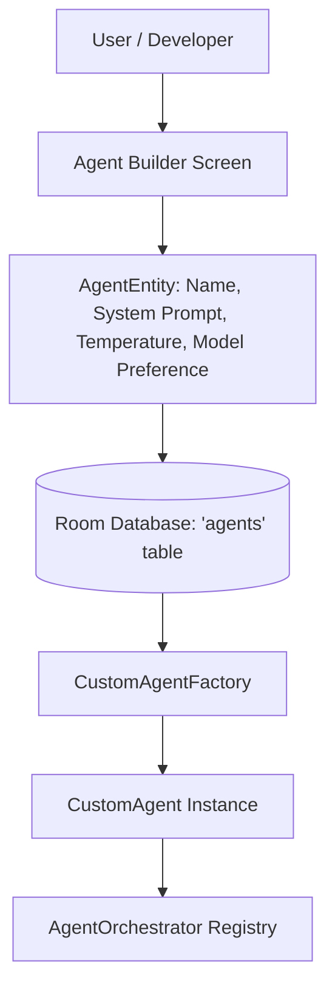

# Custom Agent Builder & Dynamic Agent Guide

AgentDroid allows power users and developers to create new specialized agents dynamically without recompiling the application. Dynamic agents are stored in the Room database (`agents` table) with `role = "CUSTOM"` and registered with `AgentOrchestrator` at runtime.

---

## 1. Custom Agent Architecture



---

## 2. Dynamic Agent Configuration Parameters

A custom agent is defined by the following attributes:

| Field | Type | Description |
|---|---|---|
| `name` | String | User-facing display name (e.g., *"Legal Contract Reviewer"*). |
| `description` | String | Purpose description used by Master Agent for automatic delegation. |
| `systemPrompt` | String | Core instructions, tone guidelines, and output constraints. |
| `modelOverride` | String? | Specific model identifier (e.g., `gpt-4o`, `llama3:70b`), or null to inherit system default. |
| `temperature` | Float | Sampling temperature (`0.0` for strict logic, `0.8` for creative brainstorming). |
| `maxTokens` | Int | Upper token limit per response turn. |
| `allowedTools` | List\<String\> | List of permitted action names (`OPEN_APP`, `EXTRACT_SCREEN_TEXT`). |

---

## 3. Programmatic Registration via SDK

You can programmatically construct and register a custom agent:

```kotlin
val customAgent = AgentEntity(
    id = UUID.randomUUID().toString(),
    role = "CUSTOM",
    name = "Code Auditor Agent",
    description = "Specializes in Kotlin static analysis and Android security vulnerabilities.",
    systemPrompt = "You are an expert security engineer. Review Android Kotlin code for vulnerabilities.",
    temperature = 0.2f,
    maxTokens = 4096,
    isEnabled = true
)

// Persist to Room database
agentDao.insertAgent(customAgent)

// Orchestrator immediately picks up the new agent via reactive Room Flow
```

---

## Related Documentation
* [Agent Development Guide](file:///workspaces/agentdroid-/docs/developer/AGENT_DEVELOPMENT.md)
* [Database Schema](file:///workspaces/agentdroid-/docs/architecture/DATABASE_SCHEMA.md)
* [Agent Fleet Management](file:///workspaces/agentdroid-/docs/user-guide/AGENT_MANAGEMENT.md)
