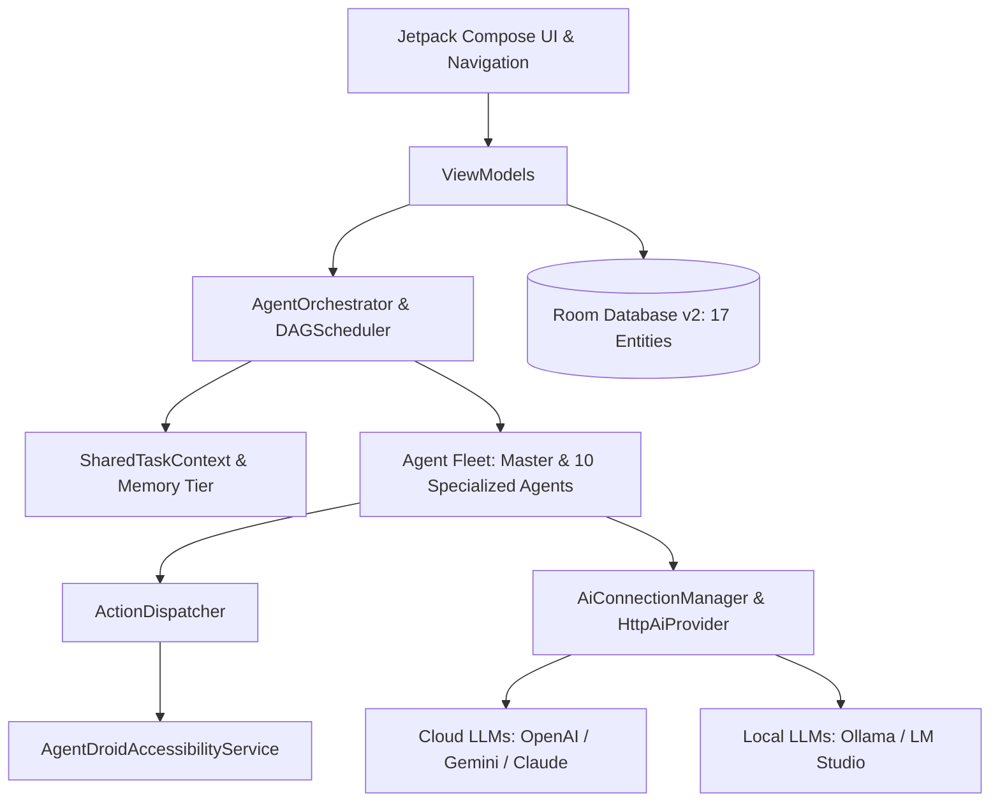

# AgentDroid Developer Guide & Onboarding

Welcome to the AgentDroid engineering ecosystem. AgentDroid is an open-source, multi-agent AI operating platform built natively for Android using Kotlin and Jetpack Compose.

---

## 1. Engineering Principles

1. **Strict Real AI**: Zero hardcoded AI responses. If a provider fails or credentials are missing, emit an explicit, typed `AiError` rather than fabricating simulated responses.
2. **Local-First & Privacy Preserving**: User data, encryption keys, and agent memories must stay on-device unless explicitly delegated to a user-configured AI endpoint.
3. **Reactive Unidirectional Data Flow (UDF)**: UI state flows downward via Compose states; user intents flow upward via ViewModel events.
4. **Deterministic Orchestration**: Multi-agent task plans are structured as Directed Acyclic Graphs (DAGs) with explicit dependency resolution and isolated execution contexts.

---

## 2. High-Level Architecture Overview

---

## 3. Contribution Workflow

1. **Fork & Branch**: Create feature branches off `main` following the naming convention:
   * `feat/agent-<name>`
   * `fix/navigation-<target>`
   * `docs/<topic>`
2. **Build & Verify Locally**:
   * Compile and run unit tests: `./gradlew testDebugUnitTest`
   * Build debug APK: `./gradlew assembleDebug`
3. **Pull Request Protocol**:
   * Reference open issues or task IDs.
   * Provide sample prompt inputs and agent step outputs.
   * Ensure 100% test pass rate with zero lint regressions.

---

## Related Documentation
* [Development Setup](file:///workspaces/hacknova/docs/developer/DEVELOPMENT_SETUP.md)
* [Project Structure](file:///workspaces/hacknova/docs/developer/PROJECT_STRUCTURE.md)
* [System Architecture](file:///workspaces/hacknova/docs/architecture/SYSTEM_ARCHITECTURE.md)
