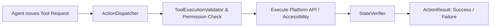

# Tool & Action Development Guide

Agents in AgentDroid interact with the physical device, Android OS, and external services via **Tools** dispatched through `ActionDispatcher`.

---

## 1. Tool Architecture



---

## 2. Adding a New Action

Adding a new tool requires three steps:

### Step 1: Declare the Action in `ActionType`
Add the new action constant to the `ActionType` enum:
```kotlin
enum class ActionType {
    OPEN_APP,
    CLICK_ELEMENT,
    TYPE_TEXT,
    SCROLL_SCREEN,
    NAVIGATE_BACK,
    NAVIGATE_HOME,
    EXTRACT_SCREEN_TEXT,
    TAKE_SCREENSHOT,       // Newly added action
    // ...
}
```

### Step 2: Implement Execution Logic in `ActionDispatcher`
```kotlin
private suspend fun handleTakeScreenshot(params: Map<String, Any?>): ActionResult {
    // Check permission / security level
    if (!permissionManager.hasScreenshotPermission()) {
        return ActionResult.Failure(error = "Screenshot permission denied by system.")
    }

    val bitmap = accessibilityService.captureDisplay()
        ?: return ActionResult.Failure(error = "Screen capture returned null.")

    val savedPath = storageManager.saveScreenshot(bitmap)
    return ActionResult.Success(data = mapOf("file_path" to savedPath))
}
```

### Step 3: Implement Post-Action State Verification
When applicable, register verification logic in `StateVerifier` to ensure the tool achieved its intended real-world side effect before returning control to the agent.

---

## 3. Tool Security Rules

* **Zero Shell Execution**: Direct `Runtime.getRuntime().exec()` or root shell calls are strictly disallowed.
* **Input Sanitization**: All file paths and text inputs must be sanitized to prevent directory traversal or intent injection.
* **High-Risk Tagging**: If an action can cause monetary loss, data deletion, or privacy exposure, mark it as `requiresApproval = true` to force user confirmation.

---

## Related Documentation
* [Tool Execution Security](file:///workspaces/hacknova/docs/security/TOOL_EXECUTION_SECURITY.md)
* [Tool Interfaces](file:///workspaces/hacknova/docs/api/TOOL_INTERFACES.md)
* [Android Integration](file:///workspaces/hacknova/docs/architecture/ANDROID_INTEGRATION.md)
