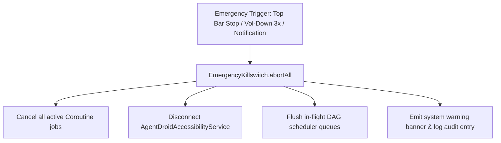

# Disaster Recovery & Emergency Operations

This document establishes operational response procedures for critical system failures, persistent crashes, and runaway agent automation loops.

---

## 1. Emergency Runaway Agent Abort (Killswitch)

If an agent enters an infinite loop, clicks unintended UI elements, or executes runaway background tasks:

* **Immediate Abort Channels**:
  1. **Red Stop Button**: Tapping the top app bar stop icon immediately signals `EmergencyKillswitch.abortAll()`.
  2. **Physical Key Binding**: Pressing the physical **Volume Down** button 3 times within 1.5 seconds halts all active automation tasks.
  3. **Foreground Notification**: Tap **ABORT** on the persistent execution notification.

---

## 2. SQLite Database Corruption Recovery

In the rare event of SQLite file corruption (e.g., sudden power loss during a write transaction):
1. The app catches `SQLiteDatabaseCorruptException`.
2. The database manager marks the file for safe recreation.
3. On next restart, the database is re-initialized with standard default agents (`AgentDroidDatabase.kt`).
4. User configurations stored in encrypted preferences are preserved.

---

## 3. Emergency Factory Reset (Clean Slate)

To return the entire app to a pristine state:
1. Open Android **Settings → Apps → AgentDroid**.
2. Tap **Storage & Cache → Clear Storage**.
3. Re-launch AgentDroid to generate fresh Keystore encryption keys and seed default agents.

---

## Related Documentation
* [Backup and Restore](file:///workspaces/agentdroid-/docs/operations/BACKUP_AND_RESTORE.md)
* [Tool Execution Security](file:///workspaces/agentdroid-/docs/security/TOOL_EXECUTION_SECURITY.md)
* [Troubleshooting Guide](file:///workspaces/agentdroid-/docs/user-guide/TROUBLESHOOTING.md)
