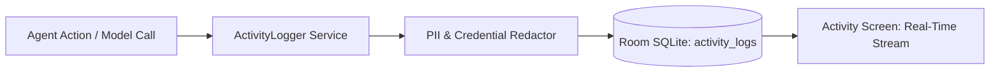

# Operational Logging & System Monitoring

AgentDroid maintains comprehensive, privacy-preserving operational logs directly on-device to facilitate auditing, troubleshooting, and resource accounting.

---

## 1. Audit Logging Architecture

Every tool invocation, model query, and agent transition is recorded into the `activity_logs` table:

Fields recorded per log entry:
* `timestamp`: Epoch milliseconds.
* `agent_id`: Identifier of the executing agent.
* `action_type`: Tool or inference event name.
* `status`: `SUCCESS`, `FAILED`, `PENDING_APPROVAL`.
* `duration_ms`: Execution latency in milliseconds.
* `token_count`: Estimated input and output tokens consumed.

---

## 2. Token & Resource Monitoring

Users and administrators can monitor usage metrics via the **Activity** tab:
* **Total Invocations**: Aggregate counts broken down by agent role.
* **Token Expenditure**: Estimated token usage per cloud provider to manage API costs.
* **Error Rate**: Percentage of failed requests, highlighted by category (rate limit, network, auth).

---

## 3. Log Retention & Auto-Pruning

To prevent uncontrolled SQLite database growth on user devices:
* Audit logs are subject to a default **30-day rolling retention policy**.
* The maximum log count is capped at 10,000 entries. Entries older than 30 days are automatically pruned during nightly WorkManager maintenance tasks.

---

## Related Documentation
* [Performance Tuning](file:///workspaces/hacknova/docs/operations/PERFORMANCE.md)
* [Database Schema](file:///workspaces/hacknova/docs/architecture/DATABASE_SCHEMA.md)
* [Data Protection](file:///workspaces/hacknova/docs/security/DATA_PROTECTION.md)
