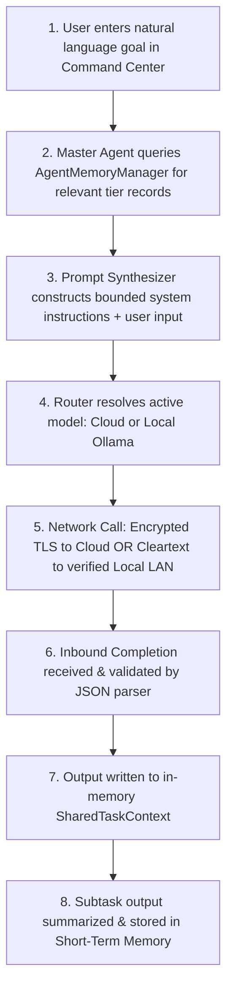

# AI Data Processing Lifecycle

## End-to-End Processing Flow

---

## Tokenization & Parameter Safeguards

1. **Temperature & Max Tokens**: Configurable per agent role in `model_configurations` (e.g. Master Agent uses `temperature: 0.2` for deterministic JSON planning, Content Creation Agent uses `0.85` for creativity).
2. **Context Compression**: Memories older than the rolling window are excluded from prompt construction, keeping prompt sizes within model context boundaries.
3. **Structured Enclosure**: System instructions are strictly isolated from user goals and external web snippets, preventing system instruction override.
