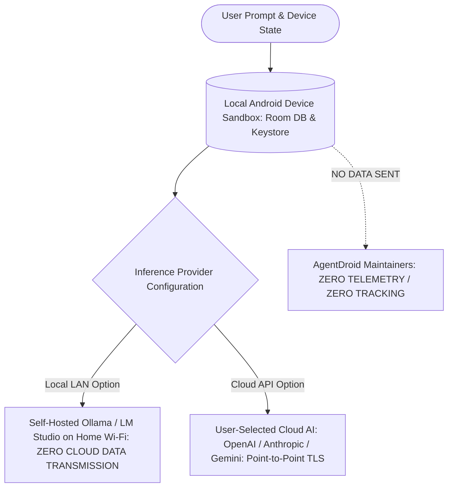

# Privacy Overview

## Core Privacy Architecture: Data Sovereignty

AgentDroid is architected on the principle of **User Data Sovereignty**:
1. **Zero Tracking SDKs**: AgentDroid contains no third-party advertising SDKs, tracking pixels, or developer analytics beacons.
2. **Local-First Architecture**: Your tasks, activity logs, workflows, and 5-tier memory records reside on your physical device in encrypted/sandboxed SQLite storage.
3. **Inference Transparency**: Prompts and context are transmitted **only** to the specific AI provider endpoint explicitly configured by you (e.g. OpenAI, Anthropic, Gemini, or your private self-hosted Ollama server).

---

## Local AI vs. Cloud AI Privacy Profile

| Dimension | Local LLM (Ollama, LM Studio) | Cloud APIs (OpenAI, Gemini, Anthropic) |
| :--- | :--- | :--- |
| **Inference Location** | Your device or local computer on Wi-Fi | Vendor-operated cloud data centers |
| **Data Transmission** | Stays within private local network (`192.168.x.x`) | Transmitted over public internet via TLS 1.2+ |
| **Data Retention** | Determined entirely by your server config | Subject to vendor's commercial API privacy policy |
| **Model Training** | Models are never trained on your inputs | Commercial API terms typically exclude training |
| **Cost** | Free (consumes local compute) | Consumes API tokens billed by vendor |
