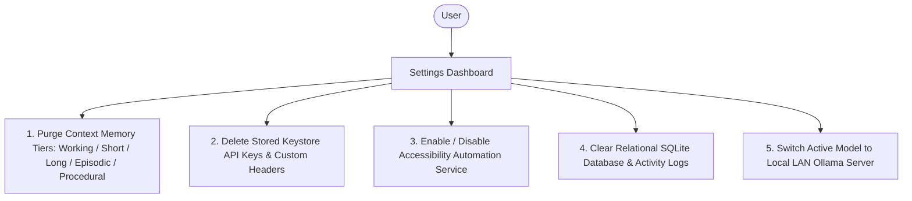

# User Data Control & Sovereign Rights

## Sovereign Privacy Controls in AgentDroid

AgentDroid provides native, granular controls empowering users to govern their data:

---

## Alignment with Global Privacy Frameworks

### 1. Indian Digital Personal Data Protection Act (DPDPA 2023)
* **Right to Access & Rectify**: Users can view all memory records, discovered models, and execution logs directly in the app UI.
* **Right to Erasure**: Instantaneous single-tap memory purging permanently deletes records from local SQLite storage.
* **Consent Architecture**: Clear affirmative action required when enabling Accessibility Services or adding API keys.

### 2. General Data Protection Regulation (GDPR)
* **Data Minimization (Art. 5(1)(c))**: AgentDroid stores only data strictly required for task execution.
* **Integrity & Confidentiality (Art. 5(1)(f))**: Hardware Keystore AES-256 GCM encryption.
* **Right to Erasure / "To be Forgotten" (Art. 17)**: Users hold physical possession of all data on their device and can wipe records at will.
