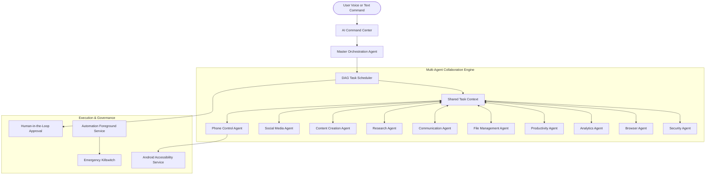

# AgentDroid Product Overview

## Executive Summary

AgentDroid is a production-grade multi-agent AI operating system engineered natively for the Android platform (API level 26+). Rather than acting as a traditional text-in/text-out chatbot, AgentDroid functions as an autonomous, multi-agent execution environment. A centralized **Master Agent** receives natural language goals, decomposes them into Directed Acyclic Graph (DAG) task trees, and orchestrates specialized agents—spanning Phone Automation, Social Media, Content Creation, Research, Communication, File Management, Productivity, Analytics, Browser, and Device Security.

AgentDroid combines strict Real AI execution (zero fake responses or simulated thinking), hardware-backed encryption via Android Keystore (AES-256 GCM), native Accessibility Service device automation, and a multi-provider AI abstraction supporting cloud APIs (OpenAI, Gemini, Claude, OpenRouter, Groq, Together) and local private LLMs (Ollama, LM Studio, vLLM).

---

## Key Differentiators

| Capability | Traditional AI Chatbot | AgentDroid AI OS |
| :--- | :--- | :--- |
| **Execution Model** | Single conversational thread | Autonomous multi-agent Directed Acyclic Graph (DAG) execution |
| **Device Integration** | None (sandboxed in app) | Android Accessibility Service, Intents, Storage Access Framework |
| **AI Connectivity** | Single hardcoded cloud vendor | Dynamic model discovery across cloud APIs and local LAN Ollama servers |
| **Model Assignment** | Monolithic single model | Granular per-agent model assignment (e.g., Master on GPT-4o, Phone on Ollama) |
| **Privacy & Security** | Data sent to single cloud vendor | Zero mock data policy, hardware Keystore AES-256 GCM, local LAN support |
| **Safety Governance** | Post-generation prompt filters | Pre-execution Risk Level assessment, Human Approval Queue, Emergency Killswitch |
| **Context Retention** | Single ephemeral chat history | 5-Tier Memory Architecture (Working, Short-Term, Long-Term, Episodic, Procedural) |

---

## Target Audience & Deployment

1. **Power Users & Automators**: Users seeking hands-free device automation, calendar scheduling, file reorganization, and automated notifications.
2. **Social Media Managers & Creators**: Autonomous multi-platform cross-posting, content drafting, hashtag research, and analytics aggregation.
3. **Privacy-Conscious Individuals**: Users demanding local LLM inference via self-hosted Ollama or LM Studio servers on local Wi-Fi without cloud data exfiltration.
4. **Knowledge Workers & Researchers**: Deep multi-step web intelligence, competitor analyses, structured JSON citation aggregation, and executive briefing synthesis.

---

## System Capabilities Breakdown

### 1. Autonomous Multi-Agent Fleet
AgentDroid operates 11 distinct agent roles defined in `com.agentdroid.app.domain.agent`:
* **Master Agent (`MASTER`)**: Interprets natural language commands, parses intent, constructs task dependency graphs, delegates tasks, and synthesizes executive reports.
* **Phone Control Agent (`PHONE_CONTROL`)**: Automates user interaction via Android Accessibility APIs (clicking elements, scrolling, typing text, launching packages, taking screenshots).
* **Social Media Agent (`SOCIAL_MEDIA`)**: Manages campaigns, drafts posts, tracks analytics, and formats thread responses across X, LinkedIn, Instagram, and Reddit.
* **Content Creation Agent (`CONTENT_CREATION`)**: Crafts tailored marketing copy, long-form articles, and summaries matching desired brand voices.
* **Research Agent (`RESEARCH`)**: Performs web searches, scrapes structured intelligence, analyzes competitors, and compiles citations.
* **Communication Agent (`COMMUNICATION`)**: Drafts emails, triages inbound notifications, and generates context-aware correspondence.
* **File Management Agent (`FILE_MANAGEMENT`)**: Scans storage, classifies documents, detects duplicates, and parses PDFs.
* **Productivity Agent (`PRODUCTIVITY`)**: Orchestrates task lists, project milestones, calendars, and reminders.
* **Analytics Agent (`ANALYTICS`)**: Measures engagement metrics, token consumption, and automation velocity.
* **Browser Agent (`BROWSER`)**: Executes multi-step web scraping and DOM interaction.
* **Security Agent (`SECURITY`)**: Audits Android permissions, inspects URLs for phishing, and enforces safety boundaries.

### 2. Strict Real AI & Dynamic Discovery
AgentDroid enforces a strict "Real AI" architecture. Simulated agent responses, fake thinking indicators, and mock execution are prohibited in production builds. If credentials or network endpoints fail, the system exposes clear, actionable errors through `AiError` and guides the user to resolution. Available models are discovered dynamically via official provider APIs.

### 3. Native Device Automation & Human Governance
Device interactions are governed by a three-tiered risk model (`LOW`, `MEDIUM`, `HIGH`). High-risk actions—such as financial transactions, deleting files, sending external messages, or modifying system settings—trigger the **Human-in-the-Loop Approval Queue**. An persistent **Emergency Killswitch** is wired to an active Android Foreground Service notification, enabling instantaneous operational shutdown.
