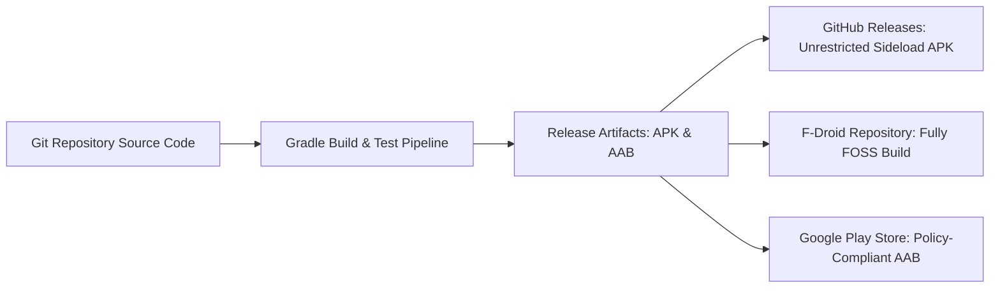

# Release Strategy

## 1. Distribution Channels

AgentDroid follows a dual-track distribution strategy to balance open-source accessibility with platform policy compliance:

### Channel A: GitHub Releases & F-Droid (Direct APK Sideload)
* **Audience**: Power users, privacy advocates, developers.
* **Capabilities**: Full access to all Accessibility Service automations, local cleartext LAN connectivity, and dynamic API configurations.
* **Format**: Signed release APK (`app-release.apk`).

### Channel B: Google Play Store (Production Track)
* **Audience**: General consumer users.
* **Compliance Requirements**:
  * Accessibility Service Disclosure compliance (prominent disclosure prior to activation).
  * Data Safety Declaration (declaring on-device storage, zero third-party telemetry trackers).
* **Format**: Signed Android App Bundle (`app-release.aab`).

---

## 2. Release Verification Gates

Before any tag or release binary is finalized, the following automated and manual quality gates must pass:

1. **Automated Unit & Integration Test Gate**: All 52 test suites (`StrictRealAiModeTest`, `NavigationTest`, `ModelDiscoveryTest`, `OllamaAndLocalLlmTest`, `DAGSchedulerTest`) must pass cleanly with 0 failures (`./gradlew testDebugUnitTest`).
2. **Deterministic Build Gate**: Successful compilation of release APK (`./gradlew assembleRelease`).
3. **Security Keystore Verification**: Ensure API keys are never stored in plaintext SharedPreferences or committed to source control.
4. **Navigation Smoke Test**: Verification of all 5 primary navigation destinations (`Dashboard`, `Agents`, `Automation`, `Activity`, `Settings`).
5. **Real AI Verification**: Verify that missing credentials or severed networks trigger explicit `AiError` dialogs with zero fallback to mock strings.
