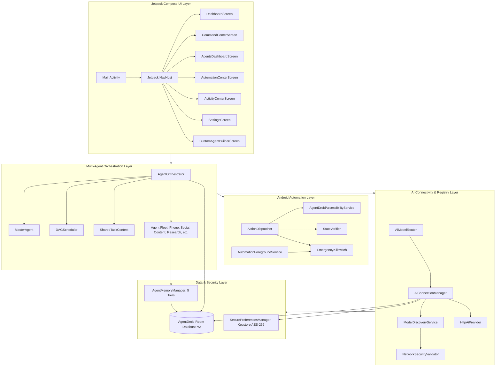
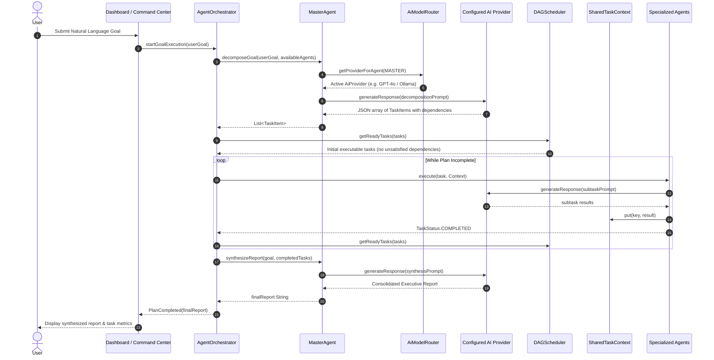
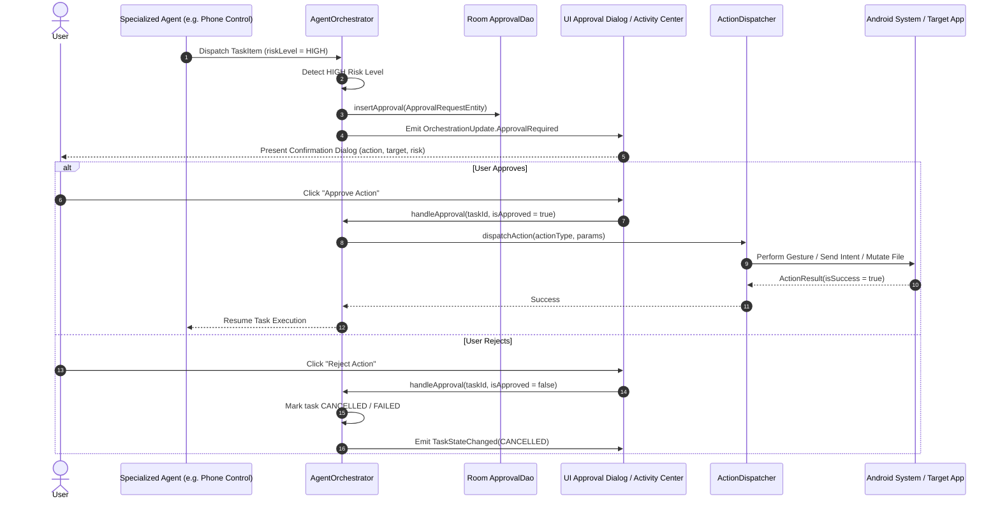
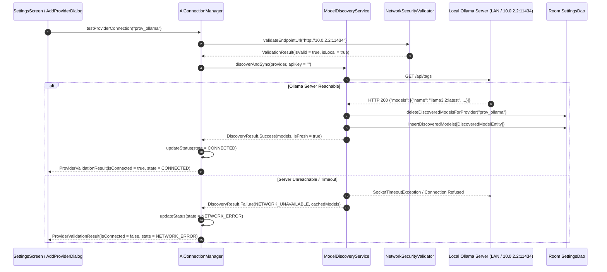
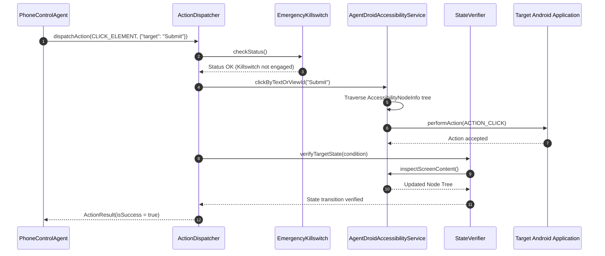

# Technical Requirements Document (TRD)

## 1. System Technology Stack

| Layer | Component / Library | Version / Details | Purpose |
| :--- | :--- | :--- | :--- |
| **Language & Runtime** | Kotlin / JVM 17 | `1.9.24` / Java 17 | Core development language with Coroutines and Flows |
| **UI Framework** | Jetpack Compose / Material 3 | BOM `2024.05.00` | Declarative UI, Obsidian Dark theme, animations |
| **Navigation** | Navigation Compose | `2.7.7` | Deep-link capable, single-activity navigation graph |
| **Local Persistence** | Android Room / SQLite | `2.6.1` (KSP) | Relational database (17 entities, DAOs, Flow emissions) |
| **Security & Crypto** | AndroidX Security Crypto | `1.1.0-alpha06` | Android Keystore backed MasterKey AES-256 GCM encryption |
| **Network Client** | Square OkHttp | `4.12.0` | HTTP/2, connection pooling, SSE streaming, NDJSON |
| **Background Work** | AndroidX WorkManager | `2.9.0` | Periodic scheduled workflow execution |
| **Android Automation** | Accessibility API | Level 26+ | Native screen inspection, gesture dispatch, app launching |
| **Foreground Service** | Android Foreground Service | `dataSync` | Safe continuous multi-agent execution & killswitch notification |

---

## 2. Component Architecture & System Topography

---

## 3. Sequence Diagrams

### 3.1 User Command Execution & Master Agent Delegation

---

### 3.2 Human-in-the-Loop Approval-Required Actions

---

### 3.3 Dynamic Model Discovery & Ollama Local Inference

---

### 3.4 Phone Automation via Android Accessibility Service

---

## 4. Technical Specifications of Subsystems

### 4.1 AI Provider Engine (`com.agentdroid.app.ai`)
* **`AiProvider` Interface**:
  * `generateResponse(prompt, systemPrompt, model, temperature, maxTokens): AiResponse`
  * `streamResponse(prompt, systemPrompt, model, temperature): Flow<String>`
  * `decomposeUserGoal(userGoal, availableAgents): List<TaskItem>`
  * `synthesizeReport(userGoal, completedTasks): String`
  * `testConnection(): Boolean`
* **`HttpAiProvider`**: Implements real HTTP communication via OkHttp with native endpoints:
  * OpenAI-Compatible: `POST /chat/completions` (OpenAI, OpenRouter, Groq, Together, LM Studio, vLLM)
  * Google Gemini: `POST /v1beta/models/{model}:generateContent?key={key}`
  * Anthropic: `POST /v1/messages` with `x-api-key` and `anthropic-version: 2023-06-01`
  * Ollama: `POST /api/chat` with options `{temperature, num_predict}`
* **Error Sanitization**: `AiError.sanitize(rawError)` intercepts raw headers, query params, and stack traces, replacing Bearer tokens, passwords, and sensitive keys with `[REDACTED]` before UI rendering or persistence.

### 4.2 Local Network Security Config (`network_security_config.xml`)
Android network security enforces TLS encryption by default while selectively permitting cleartext HTTP for local inference nodes:
* `localhost`, `127.0.0.1` (device-local daemons)
* `10.0.2.2` (Android emulator to host loopback bridge)
* `*.local`, `*.lan` (mDNS and local local-area-network domains)
* Private RFC1918 subnets (`192.168.0.0/16`, `10.0.0.0/8`, `172.16.0.0/12`) validated through `NetworkSecurityValidator`. Any remote address attempting cleartext HTTP is rejected immediately at runtime.

### 4.3 Database Architecture (Room Database v2)
17 SQLite entities managed by Room:
* `agents`, `agent_configs`: Agent identities, enabled states, and assigned parameters.
* `tasks`, `task_dependencies`: Task items, execution plans, dependency relations, retry limits.
* `agent_executions`, `activity_logs`: Audit trail of every dispatched agent action, duration, and metadata.
* `conversations`, `messages`: Natural language chat sessions, prompts, and streaming chunks.
* `memory_records`: 5-tier context storage with access counters and confidence weighting.
* `workflows`, `workflow_steps`: Reusable multi-agent automation templates and cron schedules.
* `connected_accounts`: Configured external identities (X, LinkedIn, Google, etc.).
* `api_providers`, `model_configurations`, `discovered_models`: Inference engines, model catalogs, per-agent routing tables.
* `permissions`, `approval_requests`: Human-in-the-loop governance queue.
