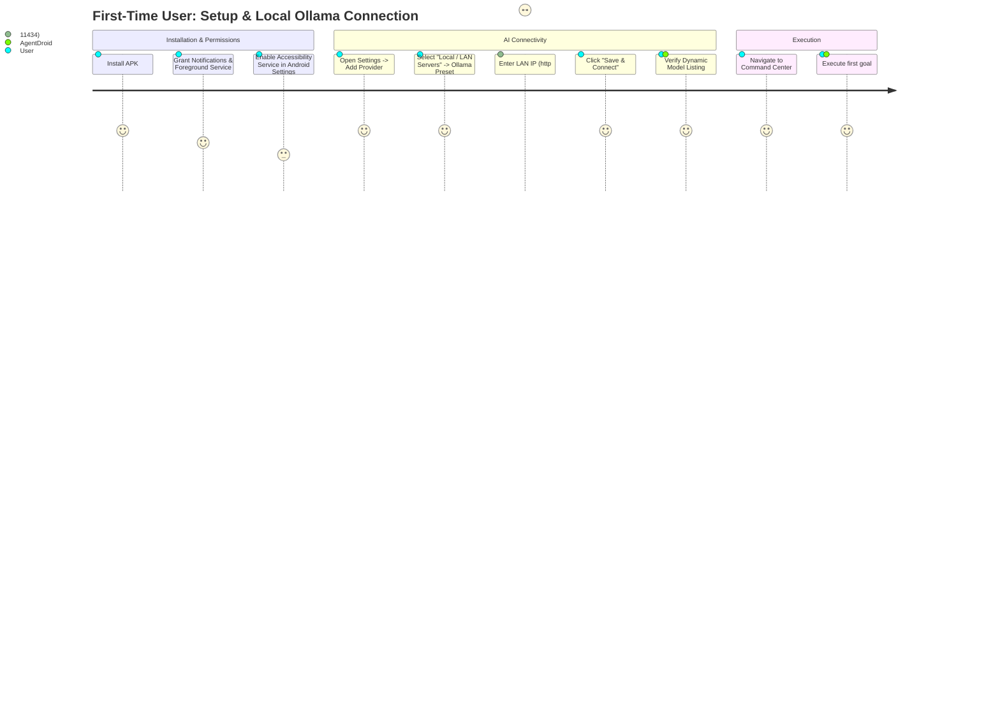
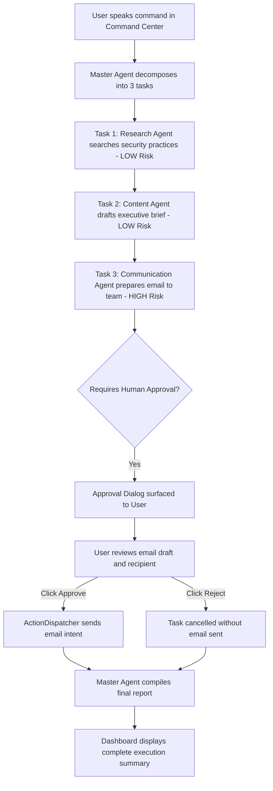

# User Journeys

## Journey 1: First-Time Setup & Local Ollama Connection

### Steps:
1. User installs AgentDroid on Android device.
2. App opens on Home Dashboard; system status displays `No AI Provider Connected`.
3. User taps `Settings` in bottom navigation.
4. Taps `Enable` on Accessibility Automation card; Android Settings opens where user enables `AgentDroid Accessibility Service`.
5. Taps `Add Provider` in AI Providers card, toggles to `LOCAL / LAN SERVERS`, and taps `Ollama Local Daemon`.
6. Replaces default `10.0.2.2` with their PC's LAN IP (`http://192.168.1.50:11434`).
7. Taps `Save & Connect`. AgentDroid calls `GET /api/tags`, discovers `llama3.2:latest`, marks status `CONNECTED`, and populates local model catalog.

---

## Journey 2: Complex Multi-Agent Goal with High-Risk Approval

### Context:
User commands: *"Research top three Android AI security practices, draft an executive brief, and prepare an email to team@company.com with the brief."*

### Steps:
1. User enters command in Command Center.
2. Master Agent queries model, breaks goal into:
   * Task 1 (`RESEARCH`): "Analyze top Android AI security guidelines" (Risk: `LOW`)
   * Task 2 (`CONTENT_CREATION`): "Synthesize research into executive brief" (Risk: `LOW`)
   * Task 3 (`COMMUNICATION`): "Send email to team@company.com with brief" (Risk: `HIGH`, depends on Task 2)
3. Task 1 and Task 2 execute autonomously; progress indicators update live.
4. Task 3 detects `HIGH` risk level. Orchestrator suspends execution and alerts user via dialog and notification.
5. User reviews email recipient and body, then taps `Approve`.
6. ActionDispatcher launches email intent; Master Agent synthesizes final report.
