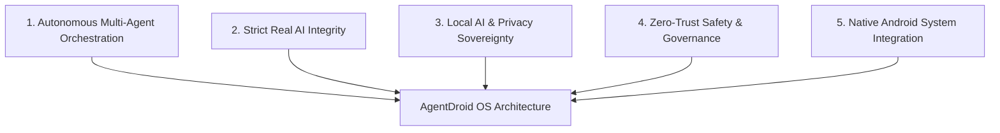

# Vision & Mission

## Vision Statement

> To transform Android into an autonomous personal AI operating system where specialized intelligent agents collaborate seamlessly, privately, and safely to execute real-world digital workflows on behalf of the user.

AgentDroid envisions a computing paradigm where the smartphone user does not manually tap through disparate apps to complete tasks. Instead, an intelligent multi-agent collective understands high-level goals, coordinates specialized micro-agents, inspects application interfaces, verifies state transitions, and presents verified reports while preserving absolute user ownership and cryptographic security.

---

## Mission Statement

Our mission is to build a reliable, open, modular, and privacy-preserving multi-agent framework on Android that:
1. **Eliminates Chatbot Passivity**: Shifts AI from passive conversational assistants to active, autonomous execution engines.
2. **Upholds Strict Real AI**: Refuses fabricated results, placeholder data, or simulated execution; every result reflects verified computation.
3. **Guarantees Local Sovereignty**: Provides first-class support for local LAN inference (Ollama, LM Studio, vLLM) so privacy-sensitive operations remain strictly within user-controlled infrastructure.
4. **Enforces Human-in-the-Loop Governance**: Balances autonomy with safety by mandating explicit cryptographic approvals for high-risk system mutations.
5. **Maintains Hardware Security**: Protects credentials and API keys via Android Keystore hardware-backed encryption (AES-256 GCM).

---

## Core Product Pillars

### Pillar 1: Autonomous Multi-Agent Orchestration
Complex digital problems cannot be solved reliably by a single generalist model prompt. AgentDroid structures tasks into Directed Acyclic Graphs (DAGs), assigning distinct subtasks to specialized agents with tailored tools, system instructions, and capability constraints.

### Pillar 2: Strict Real AI Integrity
AgentDroid rejects the industry trend of simulating progress or returning hardcoded demo data. If an API key is missing, network drops, or a local model is unavailable, AgentDroid immediately reports transparent technical details and actionable remediation steps.

### Pillar 3: Local AI & Privacy Sovereignty
Users have the fundamental right to run AI models on their own terms. AgentDroid treats local servers (Ollama, self-hosted vLLM) as first-class citizens alongside frontier cloud APIs, validating cleartext HTTP only across trusted local subnets while enforcing strict TLS for remote connections.

### Pillar 4: Zero-Trust Safety & Governance
Agents are assumed to be non-omniscient and prone to hallucinations. High-risk actions (file deletion, financial transactions, sending communications, package installations) must be explicitly approved by the user through cryptographic approval requests. A hardware-level emergency killswitch halts all operations instantly.

### Pillar 5: Native Android System Integration
AgentDroid does not remain trapped in a sandbox. Through the Android Accessibility Service, Foreground Services, Android Intents, and Content Providers, AgentDroid reads screen hierarchies, activates UI controls, scrolls lists, and orchestrates actions across installed Android applications.
