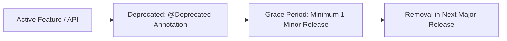

# API & Feature Deprecation Policy

To maintain agility while ensuring stability for extensions and workflows, AgentDroid enforces a structured deprecation lifecycle.

---

## 1. Deprecation Lifecycle

1. **Announcement**: The element is annotated with `@Deprecated` in Kotlin, specifying the `message` and replacement element.
2. **Grace Period**: The deprecated element remains functional for at least **one full minor release cycle** (e.g., deprecated in v1.1.0, retained in v1.2.0).
3. **Removal**: The element is removed in the next major version (e.g., v2.0.0).

---

## 2. Room Database Schema Deprecations

* Table columns marked for deprecation are retained as nullable until the subsequent major schema migration.
* Room migrations must never drop user data silently without providing an automated export or transformation path.

---

## Related Documentation
* [Software Versioning Policy](file:///workspaces/agentdroid-/docs/release/VERSIONING.md)
* [Coding Standards](file:///workspaces/agentdroid-/docs/developer/CODING_STANDARDS.md)
