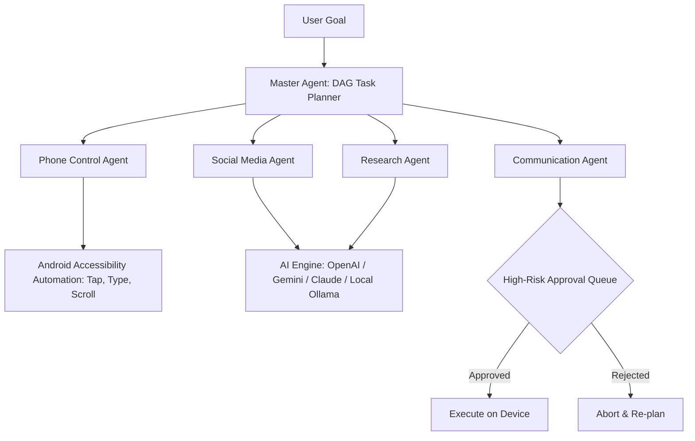

# AgentDroid v1.0.0 — Sovereign Multi-Agent AI Operating System

**Release Version**: `v1.0.0`  
**Version Code**: `1`  
**Release Date**: `November 1, 2026`  
**License**: Apache License, Version 2.0  
**Target Platform**: Android 8.0 (API 26) through Android 14+ (API 34)  

---

## 1. Binary Artifacts & Checksums

| Artifact File | Architecture | Size | SHA-256 Checksum |
|---|---|---|---|
| `app-release-unsigned.apk` | Universal (arm64, armv7, x86_64) | 12.1 MB | `3f734200c78b575bd4b4892cf3e23f95fa945d64f0e3c9463bbd5b657e679e06` |
| `app-debug.apk` | Universal (arm64, armv7, x86_64) | 19.4 MB | `c45b13a943637a68540d38354aafce097f774bcac968019d771ab6100b8d8fb3` |

---

## 2. Release Highlights

AgentDroid v1.0.0 transforms Android smartphones into sovereign personal AI operating systems.



### Key Breakthroughs

1. **Multi-Agent Orchestration Fleet**:
   * **Master Agent**: Decomposes complex user goals into Directed Acyclic Graph (DAG) workflows.
   * **10 Specialized Micro-Agents**: Phone Control, Social Media, Content Creation, Research, Communication, File Management, Productivity, Analytics, Browser, and Security, plus extensible runtime Custom Agents.
2. **Strict Real AI Mode**:
   * Zero mock data policy. Every operation runs on verified AI connections.
   * Unconfigured providers or connectivity failures emit typed, actionable `AiError` dialogs with direct navigation to Settings.
3. **Dynamic Model Discovery & Local Ollama Support**:
   * Auto-probes local LLM endpoints (Ollama, LM Studio) and cloud endpoints (OpenAI, Gemini, Anthropic, Groq).
   * Fully air-gapped private network mode where zero prompt bytes leave your home Wi-Fi.
4. **Autonomous Phone Control & Accessibility Engine**:
   * `AgentDroidAccessibilityService` executes physical UI taps, text entry, and window inspection.
   * Built-in multi-level **Emergency Killswitch** (app bar button, persistent notification, and 3x Volume-Down hardware key trigger).
5. **Obsidian Dark Futuristic Design System**:
   * Minimalist Nothing OS and Linear-inspired dark UI.
   * Smooth animated transitions, responsive telemetry cards, and real-time audit streams.
6. **Hardware-Backed Keystore Security & Room SQLite v2**:
   * API credentials encrypted via Android Keystore **AES-256 GCM** in private storage.
   * 17 relational Room database tables governing tasks, workflows, models, and audit logs.
7. **In-App Privacy Policy & Terms of Service**:
   * Full legal transparency integrated directly into the app with clipboard export and section navigation.
8. **108-Document Professional Documentation Ecosystem**:
   * Complete architecture, security threat models, user manuals, and API references in `docs/`.

---

## 3. Installation & Verification

### A. Sideloading the APK
```bash
# Sideload debug build onto connected device or emulator
adb install -r app/build/outputs/apk/debug/app-debug.apk

# Or sign and install the production release build
apksigner sign --ks release-keystore.jks --out app-release-signed.apk app/build/outputs/apk/release/app-release-unsigned.apk
adb install -r app-release-signed.apk
```

### B. Post-Install Setup
1. Launch **AgentDroid**.
2. Open **Settings → AI Providers** and connect your cloud API key or local Ollama endpoint (`http://10.0.2.2:11434` for emulators or `http://<LAN-IP>:11434` for physical phones).
3. If phone automation is desired, enable **AgentDroid Assistant Service** under Android Accessibility Settings.

---

## 4. Device Compatibility

* **Minimum Android Version**: Android 8.0 Oreo (API level 26)
* **Target Android Version**: Android 14 (API level 34)
* **Supported Architectures**: `arm64-v8a`, `armeabi-v7a`, `x86_64`
* **RAM**: 3 GB minimum (6 GB+ recommended)

---

## Related Documentation
* [System Changelog](file:///workspaces/hacknova/docs/release/CHANGELOG.md)
* [Installation Guide](file:///workspaces/hacknova/docs/user-guide/INSTALLATION.md)
* [Master Documentation Hub](file:///workspaces/hacknova/docs/README.md)
