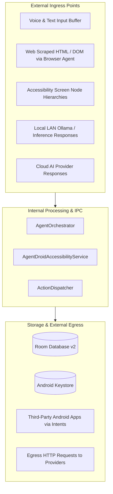

# Attack Surface Analysis

## Attack Surface Inventory

---

## Analysis of Entry Points

### 1. Natural Language Voice & Text Command Bar
* **Interface**: Compose `AICommandBar.kt` text field and microphone button.
* **Risk**: Prompt injection, buffer overruns, malformed unicode characters.
* **Mitigation**: Input sanitization, Kotlin String immutability, prompt length limits (4096 tokens).

### 2. Android Accessibility Service Screen Reader
* **Interface**: `AccessibilityEvent` stream and `AccessibilityNodeInfo` tree.
* **Risk**: Malicious third-party apps rendering deceptive text or hidden adversarial instructions to mislead the Phone Control Agent.
* **Mitigation**: Node parsing filters out non-visible and zero-alpha nodes. High-risk actions require human verification before executing clicks.

### 3. OkHttp Network Ingress (Cloud & Local LLMs)
* **Interface**: JSON responses from OpenAI, Gemini, Anthropic, and Ollama.
* **Risk**: Malformed JSON payloads, SSRF responses, prompt injection in AI completion text.
* **Mitigation**: Strict JSON parsing via `org.json`, schema validation, timeout enforcement (15s connect, 60s read).

### 4. Android IPC & Intent Filters
* **Interface**: `MainActivity` (launcher intent) and `AgentDroidAccessibilityService`.
* **Risk**: Intent spoofing from malicious third-party apps on device.
* **Mitigation**: Services require explicit Android system permissions (`BIND_ACCESSIBILITY_SERVICE`); internal broadcast intents are protected or restricted to application scope.
