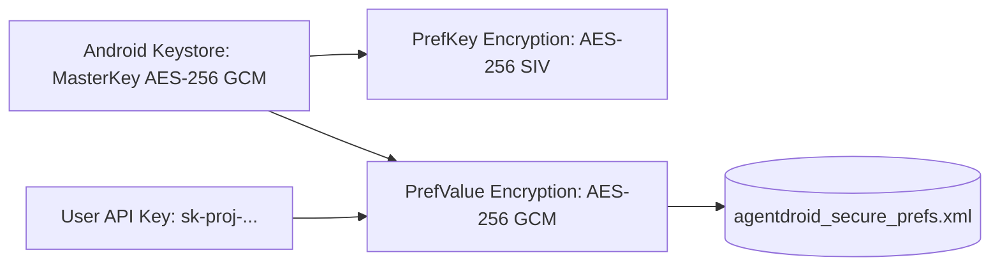

# Credential Management

## Cryptographic Architecture

AgentDroid utilizes Android's hardware-backed cryptographic subsystem via `androidx.security.crypto.EncryptedSharedPreferences`:



1. **Hardware Root of Trust**: On hardware supporting StrongBox Keymaster or TEE (Trusted Execution Environment), the `MasterKey` is generated inside hardware security modules and never exposed in application memory.
2. **Key Derivation & Schemes**:
   * Preference Key Encryption: `AES256_SIV` (deterministic encryption preventing leakage of which providers are configured).
   * Preference Value Encryption: `AES256_GCM` (authenticated encryption ensuring confidentiality and integrity).

---

## Token Redaction & Sanitization Engine

To prevent accidental credential leakage in logs or crash traces, `AiError.sanitize()` processes all inbound and outbound technical strings:

```kotlin
fun sanitize(raw: String): String {
    var sanitized = raw
    // 1. Redact Authorization Bearer headers
    sanitized = sanitized.replace(Regex("(?i)Bearer\\s+([A-Za-z0-9_\\-\\.]+)"), "Bearer [REDACTED]")
    // 2. Redact OpenAI / Anthropic sk- style keys
    sanitized = sanitized.replace(Regex("(?i)sk-[A-Za-z0-9_\\-]{10,}"), "sk-[REDACTED]")
    // 3. Redact query param keys: key=... or api_key=...
    sanitized = sanitized.replace(Regex("(?i)(api[-_]?key|key)=([A-Za-z0-9_\\-\\.]+)"), "$1=[REDACTED]")
    // 4. Redact password parameters
    sanitized = sanitized.replace(Regex("(?i)(password|secret)=([^&\\s]+)"), "$1=[REDACTED]")
    return sanitized
}
```

This guarantees that even if a vendor returns an error message echoing credentials, the UI and local activity logs only record `[REDACTED]`.
