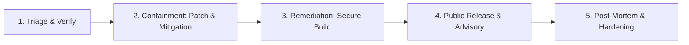

# Incident Response Plan

## Incident Severity Classification

| Severity Level | Definition | Examples | Response Target |
| :--- | :--- | :--- | :--- |
| **P0: Critical** | Exploitable vulnerability leading to remote code execution, credential exfiltration, or unauthorized device takeover. | Keystore encryption bypass, unprompted arbitrary file deletion via prompt injection. | Within 24 hours |
| **P1: High** | Security boundary bypass or privacy violation without full device takeover. | Prompt injection causing unauthorized low-risk clicks, token leak in error logs. | Within 48 hours |
| **P2: Medium** | Limited security weakness or denial-of-service condition. | Memory crash on malformed JSON payload, infinite loop in DAG scheduler. | Within 5 business days |
| **P3: Low** | Minor security hygiene issue or hardening suggestion. | Suboptimal ProGuard rule, outdated test dependency. | Next scheduled release |

---

## 5-Phase Response Lifecycle

1. **Triage & Verification**: Security maintainers acknowledge report, replicate vulnerability in isolated sandbox, and assign CVE/Severity score.
2. **Containment**: Develop emergency hotfix on private branch; draft security advisory.
3. **Remediation**: Run complete automated test suite (`52/52 tests`) and verify zero regression.
4. **Public Release**: Tag patch release (e.g., `v1.0.1`), publish binary to GitHub Releases, and notify users via release notes.
5. **Post-Mortem**: Document root cause, affected components, and add regression test cases to test suite.
