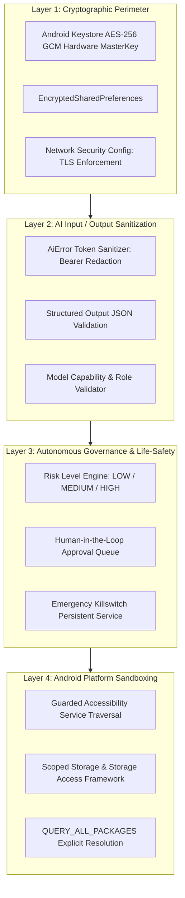

# Security Overview

## Defense-in-Depth Security Model

AgentDroid operates on a multi-layered defense-in-depth security model designed specifically for autonomous agentic systems running on mobile operating systems:

---

## Core Security Commitments

1. **Hardware-Backed Cryptography**: API keys, bearer tokens, and custom inference headers are encrypted using Android Keystore `MasterKey` with AES-256 GCM encryption.
2. **Zero Plaintext Token Logging**: The unified error engine (`AiError.sanitize`) automatically strips Bearer tokens, query parameters, and private URLs before any technical detail is rendered in UI or recorded in activity logs.
3. **No Unrestricted Cleartext HTTP**: Cleartext HTTP traffic is rejected at runtime by `NetworkSecurityValidator` unless the destination resolves to a verified local/private IP address (e.g., `127.0.0.1`, `10.0.2.2`, `192.168.0.0/16`).
4. **Human-in-the-Loop Governance**: Any autonomous action that mutates external state (sending emails, publishing social posts, deleting files, executing financial transactions) is halted until explicit user confirmation is received.
5. **Instantaneous Killswitch**: An independent killswitch halts all agent coroutines and UI gesture dispatching within milliseconds upon user activation from the persistent status bar notification.
