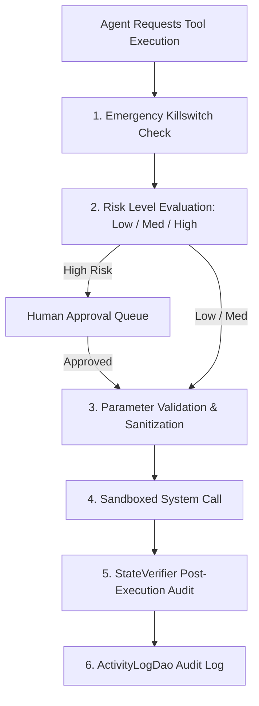

# Tool Execution Security

## Execution Boundary Specifications

All agent tools in AgentDroid execute via the centralized `ActionDispatcher` (`com.agentdroid.app.automation.action`):

---

## Tool Security Parameters & Validations

| Action Type | Security Constraints & Parameter Sanitization |
| :--- | :--- |
| `OPEN_APP` | Package name must be non-blank and resolve via `PackageManager.getLaunchIntentForPackage()`. Arbitrary intents are rejected. |
| `OPEN_URL` | URL is validated by `NetworkSecurityValidator`. Supported schemes restricted to `http` and `https`. Schemes like `file:`, `javascript:`, `content:` are rejected. |
| `CLICK_ELEMENT` | Coordinates or node IDs must belong to the active foreground application window. Clicks cannot cross secure overlay windows (e.g., system password fields). |
| `TYPE_TEXT` | Target node must accept text input (`isEditable = true`). Keylogging protections enforced by system IME. |
| `CREATE_FILE` | Writes restricted to scoped app directories (`getExternalFilesDir()`). Path traversal sequences (`../`) are stripped. |
| `DELETE_FILE` | Strictly classified as `RiskLevel.HIGH`. Absolute path verified; system partitions (`/system`, `/data`) cannot be targeted. |
| `SEND_EMAIL` | Strictly classified as `RiskLevel.HIGH`. Dispatches standard Android Intent chooser; cannot send silent background emails without user interaction. |
| `POST_SOCIAL` | Strictly classified as `RiskLevel.HIGH`. Generates pending draft; external API broadcast requires explicit approval. |
