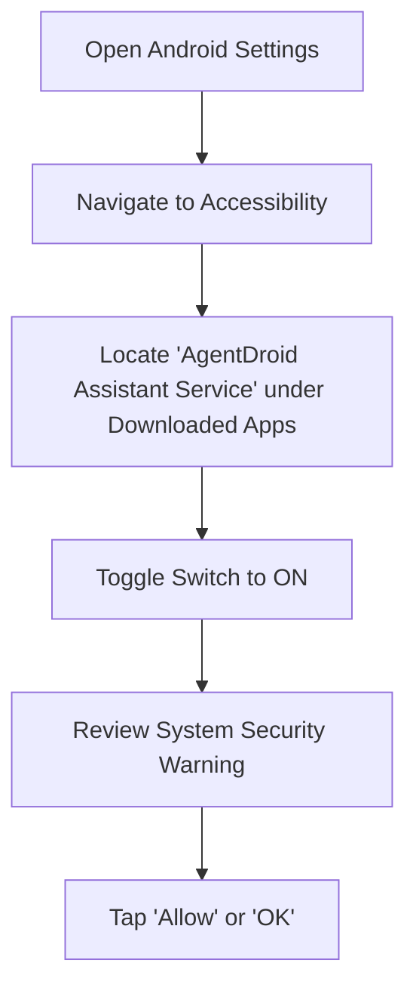

# Accessibility Service Setup Guide

To automate native applications, click buttons, and inspect screen contents, AgentDroid requires the Android **Accessibility Service** permission.

> [!IMPORTANT]
> The Accessibility Service is **strictly optional**. If you only intend to use AgentDroid for AI chat, content generation, coding, analytics, and cloud research, you do NOT need to enable Accessibility.

---

## 1. Why AgentDroid Needs Accessibility

Android isolates apps into secure sandboxes. An app cannot interact with or touch other apps without an explicit accessibility bridge. `AgentDroidAccessibilityService` provides:
* **Visual node inspection**: Reading the visible view tree on the display to identify clickable buttons and input fields.
* **Simulated user interaction**: Performing programmatic taps, scrolls, and text injection.
* **Global gestures**: Navigating Back, returning Home, and opening Notifications.

---

## 2. Step-by-Step Enablement

1. Open device **Settings**.
2. Scroll down and tap **Accessibility** (on Samsung devices: *Settings → Accessibility → Installed Apps*; on Xiaomi/MIUI: *Additional settings → Accessibility → Downloaded apps*).
3. Find **AgentDroid Assistant Service** in the list.
4. Toggle the switch to **On**.
5. Android will present a full-screen confirmation dialog explaining that the service can observe your actions and retrieve window content. Tap **Allow**.

---

## 3. Handling Android "Restricted Settings" (Android 13 & 14)

If you installed AgentDroid via manual APK sideloading on Android 13 or Android 14, Android may display:
`"Restricted setting: For your security, this setting is currently unavailable."`

To unlock this setting:
1. Open **Settings → Apps → AgentDroid**.
2. Tap the **Three Dots (⋮)** in the top right corner.
3. Tap **Allow restricted settings**.
4. Authenticate using your fingerprint, face unlock, or device PIN.
5. Return to **Settings → Accessibility → AgentDroid Assistant Service** and toggle it **On**.

---

## 4. Privacy and Data Handling Disclosure

* **Zero Cloud Exfiltration**: Screen nodes and UI text inspected by `AgentDroidAccessibilityService` are processed locally within memory on your device. They are NEVER uploaded to analytics servers.
* **Password Exemption**: Password entry fields (views with `isPassword = true`) are masked and filtered out by `AgentDroidAccessibilityService`.
* **Instant Revocation**: You can revoke accessibility access at any time by toggling the service off in Android Settings.

---

## Related Documentation
* [Phone Automation Guide](file:///workspaces/agentdroid-/docs/user-guide/PHONE_AUTOMATION.md)
* [Android Permission Model](file:///workspaces/agentdroid-/docs/security/PERMISSION_MODEL.md)
* [Privacy & Data Collection](file:///workspaces/agentdroid-/docs/privacy/DATA_COLLECTION.md)
