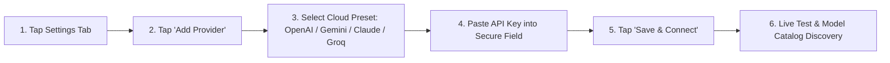

# AI Provider Setup Guide

## Adding a Cloud AI Provider

AgentDroid supports direct connection to official cloud AI APIs:

### Supported Cloud Presets:
1. **OpenAI**:
   * Base URL: `https://api.openai.com/v1`
   * Key Format: `sk-proj-...`
   * Models: `gpt-4o`, `gpt-4o-mini`, `o1-preview`, `o1-mini`
2. **Google Gemini**:
   * Base URL: `https://generativelanguage.googleapis.com`
   * Key Format: `AIzaSy...`
   * Models: `gemini-1.5-pro`, `gemini-1.5-flash`, `gemini-2.0-flash`
3. **Anthropic Claude**:
   * Base URL: `https://api.anthropic.com/v1`
   * Key Format: `sk-ant-api03-...`
   * Models: `claude-3-5-sonnet-20241022`, `claude-3-5-haiku-20241022`
4. **OpenRouter**:
   * Base URL: `https://openrouter.ai/api/v1`
   * Key Format: `sk-or-v1-...`
   * Access to 100+ open-source and proprietary models through a single key.
5. **Groq Cloud**:
   * Base URL: `https://api.groq.com/openai/v1`
   * Ultra-fast LPU inference for `llama-3.3-70b-versatile`, `mixtral-8x7b`.
6. **Together AI**:
   * Base URL: `https://api.together.xyz/v1`
   * High-speed open-source models (`meta-llama/Llama-3.3-70B-Instruct-Turbo`).

---

## Testing & Refreshing Models

On each provider card in **Settings**:
* **Test**: Sends an active validation check to the vendor endpoint. Confirms authentication and response latency in milliseconds.
* **Refresh**: Re-queries the vendor's `/models` endpoint to download newly released models accessible to your account.
* **Edit**: Update your API key or change the Base URL.
* **Delete**: Completely removes the provider, wipes all discovered models, and erases the cryptographic key from Android Keystore.
