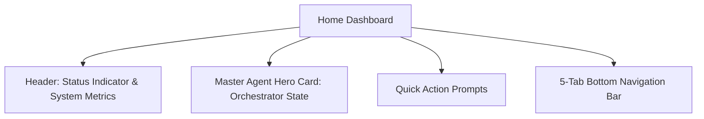

# Dashboard Guide

## 1. Overview of the Obsidian Dark Interface

AgentDroid features a futuristic, clean Obsidian Dark theme (`#08090B`) inspired by Linear, Raycast, and Nothing OS.

---

## 2. The 5 Primary Navigation Tabs

The bottom navigation bar provides instant access to the 5 primary system views:
1. **Home (`Screen.Dashboard`)**: Master Agent hero visualizer, real-time status banner, quick suggestion chips, and active execution logs.
2. **Agents (`Screen.Agents`)**: Fleet inspector displaying all 10 specialized agents, their capabilities, and custom agent builder shortcut.
3. **Automations (`Screen.Automation`)**: Reusable multi-step workflow templates, scheduled routines, and WorkManager triggers.
4. **Activity (`Screen.Activity`)**: Chronological audit timeline of every dispatched action, intermediate output, and pending approval request.
5. **Settings (`Screen.Settings`)**: AI Provider management, dynamic model picker, per-agent model assignments, accessibility status, and 5-tier memory controls.

---

## 3. Status Indicators Explained

* 🟢 **Real AI Engine Online (Green)**: At least one AI provider is authenticated, verified, and ready.
* 🟡 **Configured / Connecting (Amber / Violet)**: An API key or local URL is present; connection test or model discovery is in progress.
* 🔴 **No AI Provider Connected (Red)**: No provider configured, or credentials failed. Tap the banner to open Settings and connect a model.
