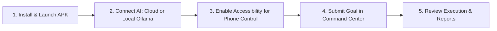

# Getting Started with AgentDroid

Welcome to **AgentDroid**, your personal AI operating system on Android. Unlike ordinary chatbots that only talk, AgentDroid is an autonomous multi-agent platform capable of understanding goals, planning multi-step tasks, coordinating specialized AI agents, and automating native Android apps.

---

## 3 Core Concepts You Need to Know

1. **The Master Agent**: The central controller. When you submit a request like *"Research our competitors, write a summary report, and schedule a social post"*, Master Agent analyzes the goal, creates a Directed Acyclic Graph (DAG) task plan, and delegates each part to specialized agents.
2. **Specialized Agents**: 10 purpose-built micro-agents (Phone Control, Social Media, Content Creation, Research, Communication, File Management, Productivity, Analytics, Browser, and Security).
3. **Strict Real AI Mode**: AgentDroid has a zero-fake-data policy. Everything runs on genuinely connected AI models—either cloud APIs (OpenAI, Gemini, Claude, Groq) or local private LLMs (Ollama, LM Studio) running over your home Wi-Fi.

---

## Next Steps

To get your system up and running, follow our step-by-step guides:
* [Installation Guide](file:///workspaces/agentdroid-/docs/user-guide/INSTALLATION.md)
* [First Time Setup & Permissions](file:///workspaces/agentdroid-/docs/user-guide/FIRST_TIME_SETUP.md)
* [AI Provider Setup (Cloud & Local)](file:///workspaces/agentdroid-/docs/user-guide/AI_PROVIDER_SETUP.md)
