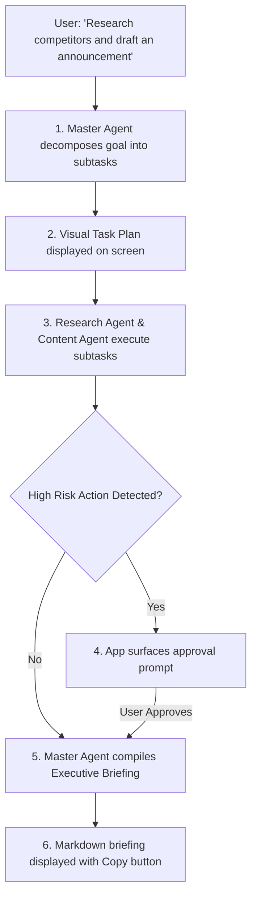

# Master Agent & Command Center Guide

## Submitting Goals to the Master Agent

The **AI Command Center** is your primary natural language interface. To launch a multi-agent operation:
1. Tap any quick suggestion chip on the Dashboard, or type directly into the **AI Command Bar**.
2. Alternatively, tap the **Microphone** icon to dictate your request via speech-to-text.
3. Tap **Send** (violet arrow button).

---

## What Happens During Execution

### 1. Planning Phase
The Master Agent's orb pulses with a subtle radial glow as it consults the configured reasoning model. Within 1–3 seconds, the interactive task plan appears, showing:
* Subtask title
* Assigned specialized agent (e.g. `Research Agent`, `Content Creation Agent`)
* Risk Level badge (`LOW`, `MEDIUM`, `HIGH`)

### 2. Execution Phase
As tasks execute, real-time status chips transition:
* `PENDING` $\rightarrow$ `RUNNING` $\rightarrow$ `COMPLETED`
You can tap any individual task card to inspect its intermediate data outputs.

### 3. Final Report Synthesis
When all tasks in the DAG finish, the Master Agent compiles an executive briefing synthesizing the results. You can tap **Copy Briefing** to copy the formatted Markdown directly to your clipboard.
