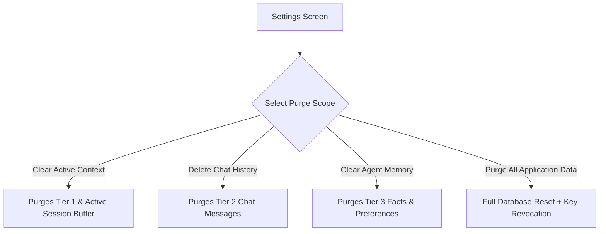

# Memory Management User Guide

AgentDroid is built with an advanced multi-tier memory architecture that allows agents to remember user preferences, reference past tasks, and maintain conversational continuity over long periods of time.

---

## 1. The 5 Tiers of Memory

AgentDroid organizes memories into five distinct storage layers:

| Tier | Type | Storage Target | Retention Lifecycle |
|---|---|---|---|
| **Tier 1: Working Memory** | Execution Context | In-Memory (Kotlin State) | Cleared when active task completes or app terminates. |
| **Tier 2: Short-Term Memory** | Session Messages | Room SQLite (`chat_messages`) | Retained across sessions; scoped to conversation threads. |
| **Tier 3: Long-Term Memory** | Key-Value Facts & Preferences | Room SQLite (`context_memory`) | Persistent until explicitly modified or deleted. |
| **Tier 4: Semantic Memory** | Knowledge Embeddings | Room SQLite / Vector Store | Preserved for contextual similarity search. |
| **Tier 5: Episodic Memory** | Activity & Audit Logs | Room SQLite (`activity_logs`) | Rolling 30-day default audit history. |

---

## 2. Viewing Memory Records in Settings

You can inspect the state of your memory storage directly from the app interface:

1. Open **Settings** from the bottom navigation bar.
2. Scroll to the **Data & Memory Management** section.
3. Review the real-time record counters:
   * **Active Conversations**: Number of chat sessions stored.
   * **Learned Facts**: User preferences and context keys retained.
   * **Audit Log Entries**: Total actions logged by agents.

---

## 3. Purging and Resetting Memory

AgentDroid puts you in complete control of your historical data:

* **Clear Session Context**: Removes temporary context variables from the active conversation thread while preserving saved facts.
* **Purge Conversation History**: Deletes all past messages and interaction transcripts.
* **Purge All Memories**: Deletes all entries from the `context_memory` table, returning the AI agents to a fresh, unpersonalized state.
* **Full Data Wipe**: Erases all local database records and regenerates encryption keys.

---

## Related Documentation
* [Memory Architecture Specification](file:///workspaces/hacknova/docs/architecture/MEMORY_ARCHITECTURE.md)
* [Data Retention Policies](file:///workspaces/hacknova/docs/privacy/DATA_RETENTION.md)
* [Privacy & Security Settings](file:///workspaces/hacknova/docs/user-guide/PRIVACY_SETTINGS.md)
