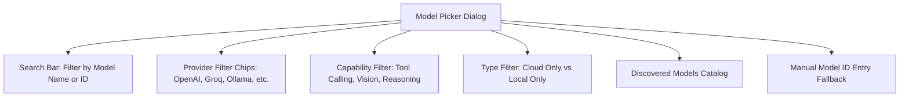

# Model Selection & Per-Agent Assignment

## 1. The Model Picker Dialog

AgentDroid features a dedicated, searchable **Model Picker Dialog**:

---

## 2. Filtering Models by Capabilities

Certain agents require specific capabilities to function. In the Model Picker, you can tap capability filter chips:
* **`TOOL CALLING`**: Required by **Phone Control Agent** and **Research Agent** to execute Android gestures and search tools.
* **`VISION`**: Required for reading on-screen images and OCR analysis.
* **`REASONING`**: Best for **Master Agent** decomposition and **Security Agent** audits (e.g. `o1-preview`, `DeepSeek-R1`).

---

## 3. Assigning Models to Specific Agents

In **Settings $\rightarrow$ Agent Model Assignments**:
1. Scroll to the target agent (e.g., **Phone Control Agent**).
2. Note the required capabilities badges (e.g., `TOOL CALLING`, `REASONING`).
3. Tap **Change Model**.
4. The Model Picker opens filtered for that agent.
5. Tap your preferred model (e.g., `Ollama: llama3.2` or `OpenAI: gpt-4o-mini`).
6. The assignment is saved to Room DB and applies immediately to future task plans!

---

## 4. Manual Model ID Entry

If your organization has private fine-tuned models that are not exposed via public listing endpoints:
1. Open the Model Picker and expand **Manual Model ID Entry** at the bottom.
2. Select the parent provider (e.g., `OpenAI`).
3. Enter your fine-tuned model ID string (e.g., `ft:gpt-4o:my-org:custom-v1`).
4. Tap **Assign Manual Model**. AgentDroid saves the model and binds it to the selected agent.
