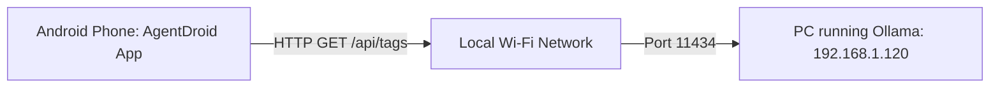

# Ollama Local LLM Setup Guide

## 1. Overview & Understanding Android Networking

AgentDroid natively integrates with **Ollama** (`https://ollama.com`), enabling completely private, offline, zero-cloud-fee AI inference across your home Wi-Fi network.

> [!IMPORTANT]
> **Understanding `127.0.0.1` on Android**:  
> From an Android device, `127.0.0.1` refers to **the Android phone itself**, NOT your computer!  
> If Ollama is running on your laptop or desktop, entering `http://127.0.0.1:11434` on your phone will fail to connect. You must use your computer's reachable local network IP address (e.g. `http://192.168.1.100:11434`).

---

## 2. Step 1: Install & Configure Ollama on Your Computer

1. Download and install Ollama from [ollama.com](https://ollama.com).
2. Pull your desired models from terminal:
   ```bash
   ollama pull llama3.2
   ollama pull mistral
   ollama pull qwen2.5:7b
   ```
3. **Configure Ollama to Listen on Your Local Network**:  
   By default, Ollama only listens on `127.0.0.1` (localhost). You must instruct it to listen on `0.0.0.0` so your Android phone can reach it over Wi-Fi:
   * **macOS**:
     ```bash
     launchctl setenv OLLAMA_HOST "0.0.0.0:11434"
     # Then restart the Ollama desktop app
     ```
   * **Linux (systemd)**:
     ```bash
     sudo systemctl edit ollama.service
     # In the editor, add:
     # [Service]
     # Environment="OLLAMA_HOST=0.0.0.0:11434"
     sudo systemctl daemon-reload
     sudo systemctl restart ollama
     ```
   * **Windows**:
     Open **System Properties $\rightarrow$ Environment Variables $\rightarrow$ User Variables**, add variable name `OLLAMA_HOST` with value `0.0.0.0:11434`, and restart Ollama from the system tray.

---

## 3. Step 2: Find Your Computer's LAN IP Address

Ensure your Android phone and computer are connected to the **same Wi-Fi network**:
* **macOS / Linux**: Run `ip a` or `ifconfig`. Look for your Wi-Fi interface IPv4 address (e.g., `192.168.1.120`).
* **Windows**: Run `ipconfig` in Command Prompt. Look for **IPv4 Address** under your active Wi-Fi adapter.

---

## 4. Step 3: Connect AgentDroid to Ollama



1. In AgentDroid, tap **Settings** in the bottom navigation.
2. Tap **Add Provider**.
3. Tap the **LOCAL / LAN SERVERS** tab and select **Ollama Local Daemon**.
4. Configure the **Server Base URL**:
   * **For Real Android Phone over Wi-Fi**: Enter `http://192.168.x.x:11434` (e.g. `http://192.168.1.120:11434`).
   * **For Android Studio Emulator**: Enter `http://10.0.2.2:11434` (the emulator's special loopback alias to host machine).
   * **For Termux / On-Device Local Daemon**: Enter `http://127.0.0.1:11434`.
5. Leave the **API Key** blank (Ollama does not require authentication).
6. Tap **Save & Connect**.

AgentDroid calls `GET /api/tags`. When connection succeeds, the badge changes to 🟢 **CONNECTED** and lists all models pulled on your Ollama server!

---

## 5. Troubleshooting Ollama Connections

### Issue: "Server Unreachable / Connection Refused"
* **Check Binding**: Verify Ollama is bound to `0.0.0.0:11434`, not `127.0.0.1:11434`. Test by opening `http://<your-pc-ip>:11434` in Chrome on your Android phone. If Chrome cannot load "Ollama is running", check your PC's firewall.
* **Firewall**: On Windows/macOS, allow inbound connections on TCP port `11434`.

### Issue: "No Local Models Found"
* If AgentDroid reports *"No local models found on the Ollama server"*, you have not pulled any models yet. Run `ollama run llama3.2` on your PC, then tap **Refresh** in AgentDroid.
