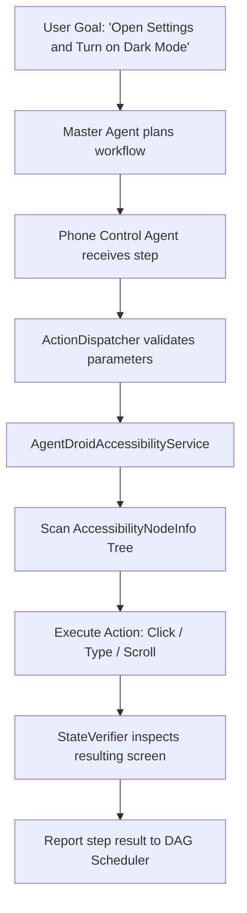

# Phone Automation User Guide

AgentDroid's **Phone Control Agent** gives your device autonomous robotic execution capabilities. Using the Android Accessibility Framework, AgentDroid inspects UI elements on screen and executes physical gestures (tap, type, scroll, navigate) on your behalf.

---

## 1. Supported UI Actions

The Phone Control Agent utilizes `ActionDispatcher` and `AgentDroidAccessibilityService` to perform low-level interactions:

| Action | Technical Name | Parameters | Description |
|---|---|---|---|
| **Open Application** | `OPEN_APP` | `package_name` (e.g., `com.whatsapp`) | Launches target app or brings it to the foreground. |
| **Click Element** | `CLICK_ELEMENT` | `text`, `view_id`, or `content_description` | Locates element on screen and performs simulated click. |
| **Type Text** | `TYPE_TEXT` | `text`, `field_name` | Focuses target input field and injects text. |
| **Scroll Screen** | `SCROLL_SCREEN` | `direction` (`FORWARD`, `BACKWARD`) | Scrolls list or layout to reveal off-screen items. |
| **Back Button** | `NAVIGATE_BACK` | None | Triggers native system `GLOBAL_ACTION_BACK`. |
| **Home Button** | `NAVIGATE_HOME` | None | Triggers native system `GLOBAL_ACTION_HOME`. |
| **Extract Screen Text** | `EXTRACT_SCREEN_TEXT` | None | Reads visible text nodes on the current screen. |

---

## 2. How Phone Automation Works

1. **Target Identification**: The agent identifies target UI nodes using exact text matches, case-insensitive substrings, accessibility labels (`contentDescription`), or Android View resource IDs.
2. **State Verification**: After dispatching an action, `StateVerifier` waits 500ms and inspects the resulting screen state to verify that the view actually changed or opened.
3. **Execution Safety**: High-risk actions (such as sending money, modifying security settings, or deleting files) require human confirmation via the Agent Approval prompt before execution.

---

## 3. Emergency Killswitch

AgentDroid provides an immediate safety stop mechanism for automation:

* **In-App Killswitch**: Tap the bright red **EMERGENCY STOP** icon on the top app bar in the Command Center.
* **Volume Rocker Stop**: Pressing the physical **Volume Down** key three times halts all active UI automation tasks immediately.
* **Notification Action**: The persistent notification contains an **ABORT** button that instantly revokes agent focus and clears the task queue.

---

## 4. Best Practices for Phone Automation

* **Keep Screen On**: Ensure your screen does not lock during automation. AgentDroid cannot bypass Android's secure lock screen PIN/biometrics.
* **Language Match**: Agents inspect UI text in the device's current locale. If an app is in Spanish, instruct the agent with Spanish UI terms or app labels.
* **Avoid Touching Screen**: While an automation sequence is actively running, manual screen touches may disrupt UI node focus.

---

## Related Documentation
* [Accessibility Service Setup](file:///workspaces/agentdroid-/docs/user-guide/ACCESSIBILITY_SETUP.md)
* [Android Integration Architecture](file:///workspaces/agentdroid-/docs/architecture/ANDROID_INTEGRATION.md)
* [Security & Tool Execution](file:///workspaces/agentdroid-/docs/security/TOOL_EXECUTION_SECURITY.md)
