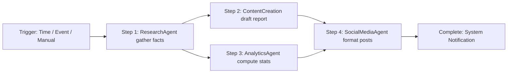

# Workflow Automation User Guide

AgentDroid's **Automation Center** allows you to link multiple agent tasks into automated pipelines known as **DAG Workflows** (Directed Acyclic Graphs). Instead of issuing one-off commands manually, workflows run complex multi-agent sequences on demand or on schedule.

---

## 1. Navigating the Automation Center

Access the Automation Center via the bottom navigation bar by tapping **Automations**.

The screen provides:
* **Active Workflows List**: Shows configured automation pipelines with enabled/disabled toggle switches.
* **Quick Run**: Execute any workflow immediately with a single tap on the **Run** button.
* **Execution History**: Tap on any workflow card to review past execution logs, duration, step statuses, and output artifacts.
* **New Workflow Action**: Tap the floating action button `+` to open the visual Workflow Creator.

---

## 2. Anatomy of a Workflow

A workflow consists of:

* **Triggers**:
  * `MANUAL`: Run directly when tapped by the user.
  * `SCHEDULED_CRON`: Runs at specified intervals (e.g., daily at 08:00 AM) using Android WorkManager.
  * `EVENT`: Triggered by device conditions (e.g., connected to Wi-Fi, low battery alert).
* **Steps**: Individual execution units assigned to specific agents (`RESEARCH`, `CONTENT_CREATION`, `PHONE_CONTROL`, etc.).
* **Dependencies**: Steps declare prerequisites (`dependsOn`). Steps without mutual dependencies execute in parallel.

---

## 3. Creating a Custom Workflow

1. Navigate to **Automations** and tap **+ Create Workflow**.
2. Enter a **Name** (e.g., *"Morning Briefing & Digest"*) and a short **Description**.
3. Select your **Trigger Type** (`MANUAL` or `SCHEDULED`).
4. Add your **Steps**:
   * Assign an Agent Role.
   * Provide the Prompt / Instruction.
   * Select dependencies if this step relies on previous output.
5. Tap **Save Workflow**.

The workflow is saved locally to your device's SQLite database (`workflows` table) and ready for execution.

---

## 4. Execution Monitoring & Logs

During workflow execution:
* Real-time progress is displayed with pulsing node indicators.
* Tapping a step reveals intermediate inputs and AI model outputs.
* In the event of a failure (such as an unreachable API endpoint or missing permission), the pipeline halts safely, and an error card is recorded in the execution log with actionable retry options.

---

## Related Documentation
* [Task Orchestration Architecture](file:///workspaces/hacknova/docs/architecture/TASK_ORCHESTRATION.md)
* [Database Schema](file:///workspaces/hacknova/docs/architecture/DATABASE_SCHEMA.md)
* [Dashboard & Navigation Guide](file:///workspaces/hacknova/docs/user-guide/DASHBOARD_GUIDE.md)
